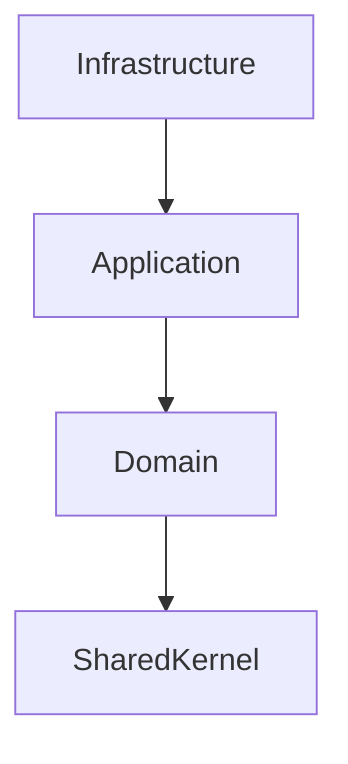
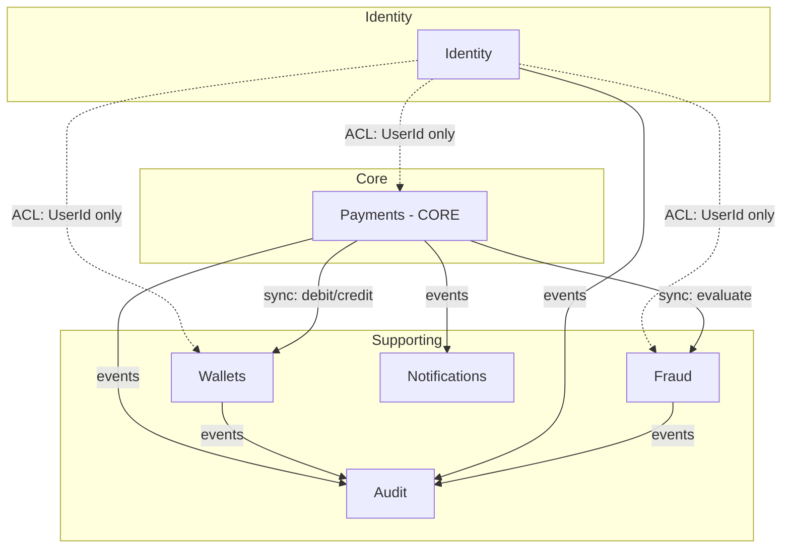

# Solution Architecture and Application Layers

> Task: **[P1W1] Describe the solution architecture and application layers (#18)**
> Related: [Bounded Contexts](./bounded-contexts.md) · [Auth Requirements](./auth-requirements.en.md) · [Roadmap](./roadmap.md)

## 1. Purpose

This document describes the **technical architecture** of the Otus Payment System solution: the layers, the dependency rules between them, the structure of the solution and projects, the patterns in use, and the cross-cutting concerns.

It **complements** bounded-contexts.md:

| Document | Answers the question |
|---|---|
| bounded-contexts.md | **What** the contexts are, where their boundaries lie, which aggregates and events exist |
| architecture.md (this) | **How** the solution is built technically: layers, dependencies, project structure |

## 2. Architectural style

The project follows **Clean Architecture** combined with **DDD** and, eventually, **CQRS**.

Key principles:

1. **Dependency Rule** — dependencies point inward, toward the domain.
2. **Domain at the center** — the domain knows nothing about the database, message broker, or web framework.
3. **Contexts as independent solutions** — each bounded context lives in its own `.sln` and folder, following a common `src` / `test` layout. This makes it easy to extract a context into a separate service later.
4. **Explicit contracts between contexts** — synchronous via API / Anti-Corruption Layer, asynchronous via domain events.

The current stage (Week 1) is a **scaffold**: solution and project structure plus base domain-event abstractions. Business logic is not implemented yet.

## 3. Application layers

Each bounded context has three layers (projects), plus a shared SharedKernel.

Dependency direction (outside in):

### 3.1 Domain

**Project:** Otus.PaymentSystem.{Context}.Domain

- **Contains:** aggregate roots and entities, value objects, domain events, domain services, domain exceptions, invariants.
- **Dependencies:** SharedKernel only. No references to EF Core, ASP.NET Core, or message brokers.
- **Rules:**
  - The domain is the single source of business rules and invariants.
  - Domain events are declared here.
  - State changes happen only through aggregate methods.

### 3.2 Application

**Project:** Otus.PaymentSystem.{Context}.Application

- **Contains:** commands and queries (CQRS), handlers (MediatR), DTOs, interfaces for external dependencies (repositories, clients, event publishers), application services and orchestration.
- **Dependencies:** Domain.
- **Rules:**
  - This layer contains **no** business rules — only orchestration of the domain.
  - External dependencies are declared as **interfaces** here and implemented in Infrastructure.
  - Recommended folders: Commands/, Queries/, DTOs/, Interfaces/, Services/.

### 3.3 Infrastructure

**Project:** Otus.PaymentSystem.{Context}.Infrastructure

- **Contains:** DbContext and EF Core configurations, repositories, external service client implementations, event publishing/subscribing, migrations.
- **Dependencies:** Domain (see section 5 on the planned dependency on Application).
- **Rules:**
  - No business logic — technical implementation only.
  - Implements interfaces declared in Application (once they exist).

### 3.4 SharedKernel

**Project:** Otus.PaymentSystem.SharedKernel

- **Contains:** a minimal set of shared abstractions: IDomainEvent, IApplicationEvent, base primitives.
- **Dependencies:** none.
- **Rules:**
  - Do not turn it into a dumping ground. Only what is genuinely shared by all contexts.

**Base event abstractions (actual code):**

- IDomainEvent — base interface: EventId, Timestamp, CorrelationId, CausationId.
- IApplicationEvent : IDomainEvent — marker for events published to the broker; adds ContextName and RoutingKey.

## 4. Solution structure

The repository is organized as a set of **independent microservice solutions**, one per bounded context, plus a standalone Shared solution. Each solution follows the same `src` / `test` layout.

Overall picture of the contexts and their interaction:

    .
    ├── Directory.Build.props        # shared MSBuild settings (TFM, nullable, analyzers)
    ├── global.json                  # pinned .NET SDK version
    ├── Shared/
    │   ├── Otus.PaymentSystem.Shared.sln
    │   ├── src/Otus.PaymentSystem.SharedKernel/
    │   └── test/
    ├── Identity/
    │   ├── Otus.PaymentSystem.Identity.sln
    │   ├── src/Otus.PaymentSystem.Identity.{Domain,Application,Infrastructure}/
    │   └── test/
    ├── Wallets/                    # same layout
    ├── Payments/                   # same layout
    ├── Fraud/                      # same layout
    ├── Notifications/              # same layout
    └── Audit/                      # same layout (with test project placeholders)

Each `.sln` contains only its own projects (and references to `Shared/src/Otus.PaymentSystem.SharedKernel` from the Domain projects).

### 4.1 Naming conventions

- Projects: Otus.PaymentSystem.{Context}.{Layer}
- Namespace matches the project name.
- Tests: Otus.PaymentSystem.{Context}.{Layer}.Tests, located in `<Context>/test/`.

## 5. Dependency rules (current state)

Actual dependencies recorded in .csproj at the time of task #18 (paths updated for the new layout):

| Layer | References |
|---|---|
| SharedKernel | — (no dependencies) |
| *.Domain | SharedKernel (`..\..\..\Shared\src\Otus.PaymentSystem.SharedKernel\...`) |
| *.Application | *.Domain |
| *.Infrastructure | *.Domain |

**Observation and tech debt.** In canonical Clean Architecture, Infrastructure usually depends on Application (implementing the interfaces declared there). Right now Infrastructure references Domain directly — correct for the current scaffold, while Application has no interfaces yet. As CQRS handlers and repository/client interfaces appear, Infrastructure should be switched to Application and this should be enforced in Architecture.Tests (see section 8).

## 6. Patterns

### 6.1 Already in use (scaffold)

- Clean Architecture — layer separation.
- DDD — aggregates and domain events in Domain.
- Domain Events — base abstractions in SharedKernel.
- Independent solutions per context — ready to be extracted into services.

### 6.2 Planned

- CQRS + MediatR — command/query separation in Application.
- Repository + Unit of Work — data access via interfaces (Application) and implementations (Infrastructure).
- Anti-Corruption Layer — isolation of external contexts (see bounded-contexts.md).
- Optimistic Locking — concurrent access to wallets.
- Outbox — reliable event publishing to the broker.

## 7. Cross-cutting concerns

| Concern | Tool | Layer |
|---|---|---|
| Validation | FluentValidation | Application |
| Logging | Serilog | Infrastructure / Host |
| Tracing | OpenTelemetry | Infrastructure / Host |
| Authentication | JWT | Host + Identity |
| Error handling | Middleware + ProblemDetails | Host |
| Configuration | IOptions + appsettings | Infrastructure / Host |

## 8. Testing

- **Domain.Tests** — unit tests for invariants and domain services.
- **Application.Tests** — handler tests with mocked dependencies.
- **Integration.Tests** — tests with a real database (Testcontainers).
- **Architecture.Tests** — Dependency Rule enforcement (Domain must not reference Infrastructure, etc.).

## 9. Target state (6 months)

- 6 bounded contexts, each with Domain/Application/Infrastructure.
- Synchronous cross-context calls via API + ACL.
- Asynchronous via RabbitMQ and domain events.
- PostgreSQL as the primary store, Redis for cache/limits.
- CQRS + MediatR, Repository + Unit of Work.
- Docker + CI/CD, monitoring (Serilog, OpenTelemetry, Prometheus, Grafana).

## 10. Related tasks

- #23 — Domain boundaries and bounded contexts → bounded-contexts.md
- #15 — Authentication and Authorization Requirements → auth-requirements.en.md
- Roadmap → roadmap.md
