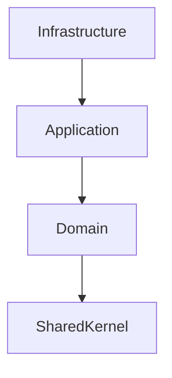
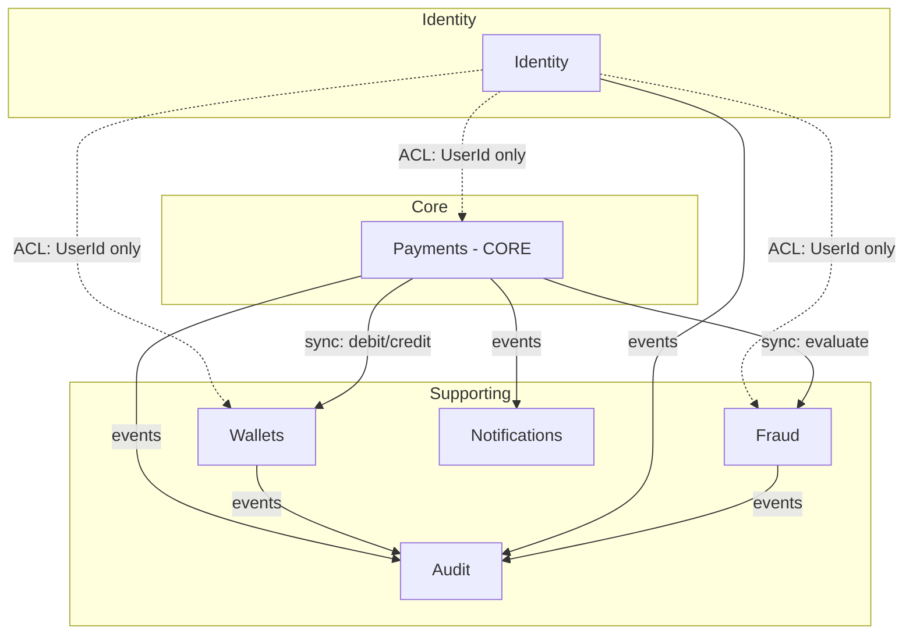

# Архитектура решения и слои приложения

> Задача: **[P1W1] Описать архитектуру решения и слои приложения (#18)**
> Связанные документы: [Bounded Contexts](./bounded-contexts.md) · [Auth Requirements](./auth-requirements.ru.md) · [Roadmap](./roadmap.ru.md)

## 1. Назначение документа

Этот документ описывает **техническую архитектуру** решения Otus Payment System: какие слои выделены, как они зависят друг от друга, как устроено решение и проекты, какие паттерны и сквозные механизмы используются.

Он **дополняет** bounded-contexts.md:

| Документ | Отвечает на вопрос |
|---|---|
| bounded-contexts.md | **Что** за контексты, где их границы, какие агрегаты и события |
| architecture.ru.md (этот) | **Как** устроено решение технически: слои, зависимости, структура проектов |

## 2. Архитектурный стиль

Проект следует **Clean Architecture** в сочетании с **DDD** и (в перспективе) **CQRS**.

Ключевые принципы:

1. **Dependency Rule** — зависимости направлены только внутрь, к домену.
2. **Domain в центре** — домен не знает ни о БД, ни о брокере сообщений, ни о веб-фреймворке.
3. **Контексты как модульный монолит** — каждый bounded context развивается независимо и в перспективе может быть выделен в отдельный сервис.
4. **Явные контракты между контекстами** — синхронные через API / Anti-Corruption Layer, асинхронные через доменные события.

На текущем этапе (Неделя 1) создан **каркас**: структура решения и проектов, базовые абстракции доменных событий. Бизнес-логика ещё не реализована.

## 3. Слои приложения

В каждом bounded context выделяются три слоя (проекта), плюс общий SharedKernel.

Направление зависимостей (снаружи внутрь):

### 3.1 Domain

**Проект:** Otus.PaymentSystem.{Context}.Domain

- **Содержит:** корни агрегатов и сущности, value objects, доменные события, доменные сервисы, доменные исключения, инварианты.
- **Зависимости:** только SharedKernel. Никаких ссылок на EF Core, ASP.NET Core, брокеры.
- **Правила:**
  - Домен — единственный источник бизнес-правил и инвариантов.
  - Доменные события объявляются здесь.
  - Изменение состояния — только через методы агрегата.

### 3.2 Application

**Проект:** Otus.PaymentSystem.{Context}.Application

- **Содержит:** команды и запросы (CQRS), обработчики (MediatR), DTO, интерфейсы внешних зависимостей (репозитории, клиенты, публикаторы событий), прикладные сервисы и оркестрацию.
- **Зависимости:** Domain.
- **Правила:**
  - Слой **не содержит** бизнес-правил — только оркестрация домена.
  - Внешние зависимости описываются **интерфейсами** здесь, реализуются в Infrastructure.
  - Рекомендуемые папки: Commands/, Queries/, DTOs/, Interfaces/, Services/.

### 3.3 Infrastructure

**Проект:** Otus.PaymentSystem.{Context}.Infrastructure

- **Содержит:** DbContext и конфигурации EF Core, репозитории, реализации клиентов внешних сервисов, публикация/подписка на события, миграции.
- **Зависимости:** Domain (см. раздел 5 о плановой зависимости от Application).
- **Правила:**
  - Никакой бизнес-логики — только техническая реализация.
  - Реализует интерфейсы, объявленные в Application (когда они появятся).

### 3.4 SharedKernel

**Проект:** Otus.PaymentSystem.SharedKernel

- **Содержит:** минимальный набор общих абстракций: IDomainEvent, IApplicationEvent, базовые примитивы.
- **Зависимости:** отсутствуют.
- **Правила:**
  - Не превращать в свалку общего кода. Только то, что действительно разделяется всеми контекстами.

**Базовые абстракции событий (реальный код):**

- IDomainEvent — базовый интерфейс: EventId, Timestamp, CorrelationId, CausationId.
- IApplicationEvent : IDomainEvent — маркер для событий, публикуемых в брокер; добавляет ContextName и RoutingKey.

## 4. Структура решения

Все проекты собраны в одном solution-файле OtusPaymentSystem.sln.

Общая картина контекстов и их взаимодействия:

    src/
    ├── Shared/Otus.PaymentSystem.SharedKernel
    ├── Identity/       {Domain, Application, Infrastructure}
    ├── Wallets/        {Domain, Application, Infrastructure}
    ├── Payments/       {Domain, Application, Infrastructure}
    ├── Fraud/          {Domain, Application, Infrastructure}
    ├── Notifications/  {Domain, Application, Infrastructure}
    └── Audit/          {Domain, Application, Infrastructure}

### 4.1 Соглашения об именовании

- Проекты: Otus.PaymentSystem.{Context}.{Layer}
- Namespace совпадает с именем проекта.
- Тесты: Otus.PaymentSystem.{Context}.{Layer}.Tests (папка tests/ внутри контекста).

## 5. Правила зависимостей (текущее состояние)

Реальные зависимости, зафиксированные в .csproj на момент задачи #18:

| Слой | Ссылается на |
|---|---|
| SharedKernel | — (нет зависимостей) |
| *.Domain | SharedKernel |
| *.Application | *.Domain |
| *.Infrastructure | *.Domain |

**Наблюдение и техдолг.** В канонической Clean Architecture Infrastructure обычно зависит от Application (реализует объявленные там интерфейсы). Сейчас Infrastructure ссылается напрямую на Domain — это корректно для текущего каркаса, пока интерфейсов в Application нет. По мере появления CQRS-обработчиков и интерфейсов репозиториев/клиентов следует переключить Infrastructure на Application и зафиксировать это в Architecture.Tests (см. раздел 8).

## 6. Паттерны

### 6.1 Уже применяются (каркас)

- Clean Architecture — разделение на слои.
- DDD — агрегаты и доменные события в Domain.
- Domain Events — базовые абстракции в SharedKernel.

### 6.2 Планируются

- CQRS + MediatR — разделение команд и запросов в Application.
- Repository + Unit of Work — доступ к данным через интерфейсы (Application) и реализации (Infrastructure).
- Anti-Corruption Layer — изоляция внешних контекстов (см. bounded-contexts.md).
- Optimistic Locking — конкурентный доступ к кошелькам.
- Outbox — надёжная публикация событий в брокер.

## 7. Сквозные механизмы (cross-cutting)

| Механизм | Инструмент | Слой |
|---|---|---|
| Валидация | FluentValidation | Application |
| Логирование | Serilog | Infrastructure / Host |
| Трассировка | OpenTelemetry | Infrastructure / Host |
| Аутентификация | JWT | Host + Identity |
| Обработка ошибок | Middleware + ProblemDetails | Host |
| Конфигурация | IOptions + appsettings | Infrastructure / Host |

## 8. Тестирование

- **Domain.Tests** — юнит-тесты инвариантов и доменных сервисов.
- **Application.Tests** — тесты обработчиков с мок-зависимостями.
- **Integration.Tests** — тесты с реальной БД (Testcontainers).
- **Architecture.Tests** — проверка Dependency Rule (Domain не ссылается на Infrastructure и т.п.).

## 9. Целевое состояние (6 месяцев)

- 6 bounded contexts, каждый по схеме Domain/Application/Infrastructure.
- Синхронные вызовы между контекстами — через API + ACL.
- Асинхронные — через RabbitMQ и доменные события.
- PostgreSQL — основное хранилище, Redis — кэш/лимиты.
- CQRS + MediatR, Repository + Unit of Work.
- Docker + CI/CD, мониторинг (Serilog, OpenTelemetry, Prometheus, Grafana).

## 10. Связанные задачи

- #23 — Определение границ доменов и bounded contexts → bounded-contexts.md
- #15 — Authentication and Authorization Requirements → auth-requirements.ru.md
- Roadmap → roadmap.ru.md
