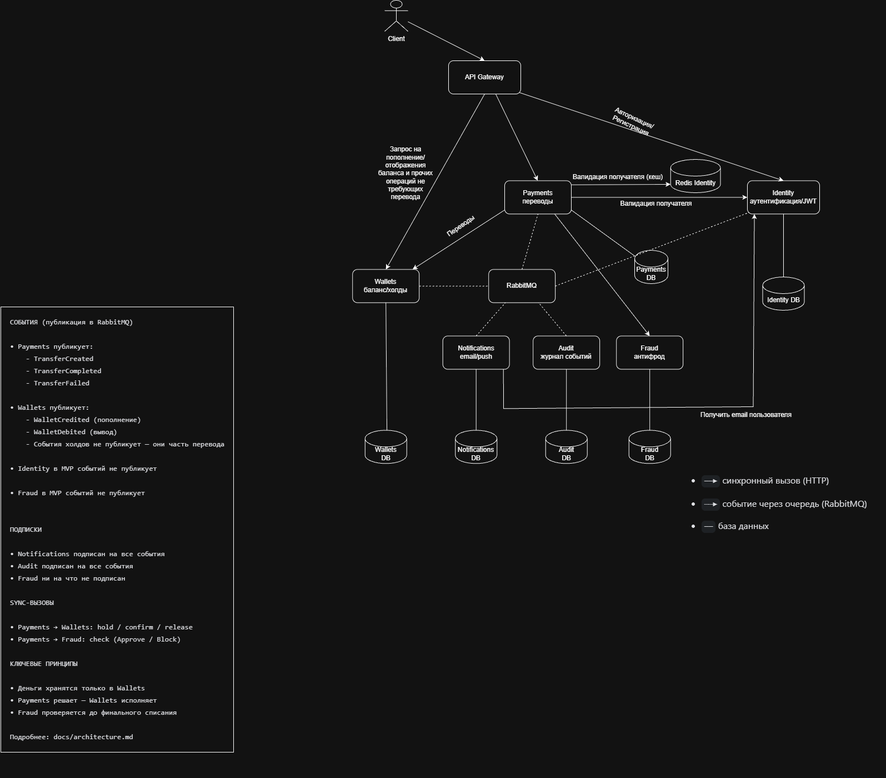
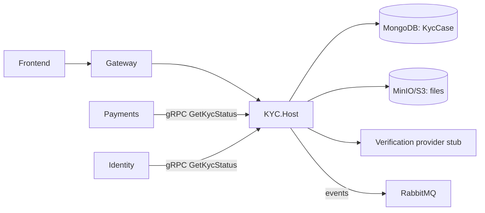
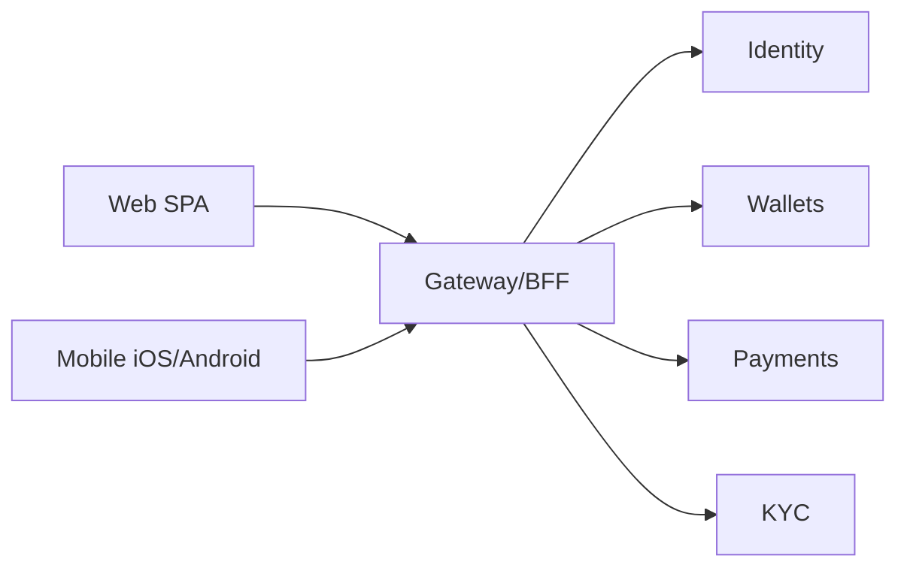

# Архитектура Otus Payment System

## 1. Обзор

Система построена как набор микросервисов. Каждый сервис владеет своей базой данных и общается с другими двумя способами:

- **Синхронно (HTTP)** — когда нужен немедленный ответ (например, Payments ждёт ответ от Wallets).
- **Асинхронно (RabbitMQ)** — когда можно «положить и забыть» (например, уведомления и аудит).

### 1.1. Состав системы

| Сервис | Роль | Ответственность |
|--------|------|-----------------|
| **Identity** | upstream | Аутентификация, выдача JWT, роли, контактные данные (email) |
| **Wallets** | supporting | Балансы пользователей, холды |
| **Payments** | **core** | Жизненный цикл перевода, все бизнес-решения, идемпотентность |
| **Fraud** | supporting | Синхронная проверка переводов, настройки fallback |
| **Notifications** | downstream | Email / push уведомления |
| **Audit** | downstream | Журнал всех событий системы |
| **KYC** | supporting, **post-1.0** | Документы, верификация личности, метаданные KYC-кейса |

Инфраструктура:
- **API Gateway** — единая точка входа для клиентов (JWT, роутинг)
- **RabbitMQ** — брокер сообщений
- **Redis** — кэш для валидации получателей (защита Identity от SPOF)
- **PostgreSQL** — своя база у каждого сервиса
- **MongoDB** — метаданные KYC-кейсов (post-1.0)
- **MinIO/S3** — файлы KYC-документов (post-1.0)
- **gRPC** — внутренний KYC API (post-1.0)

### 1.2. Ключевые принципы

1. **Деньги живут только в Wallets.** Ни один другой сервис не меняет баланс.
2. **Payments решает — Wallets исполняет.** Вся логика жизненного цикла перевода — в Payments.
3. **Холд до проверки.** Деньги резервируются до вердикта Fraud.
4. **Sync там, где нужно решение сейчас. Async там, где можно подождать.**
5. **Своя БД у каждого сервиса.** Общение только через API или события.
6. **Идемпотентность превыше всего.** Повторный запрос с тем же ключом всегда возвращает сохранённый результат, независимо от текущего состояния мира.

---

## 2. Схема взаимодействия

*Схема: см. файл `docs/images/architecture.png` (или `docs/architecture.drawio`).*

### 2.1. Связи между компонентами

**Синхронные вызовы (HTTP):**

| Откуда | Куда | Назначение |
|--------|------|------------|
| Client | API Gateway | Все запросы |
| API Gateway | Identity | `/auth/*` — логин, регистрация |
| API Gateway | Wallets | `/wallets/*` — баланс, пополнение, вывод |
| API Gateway | Payments | `/transfers/*` — переводы (только JWT-валидация и роутинг) |
| Payments | Redis | Проверка кэша валидации получателя |
| Payments | Identity | Валидация получателя (при cache miss) |
| Payments | Wallets | `hold` / `confirm` / `release` / `getHold` (для сверки) |
| Payments | Fraud | `check` (Approve / Block) |
| Payments | Fraud | `getSettings` (получение порога fallback) |
| Notifications | Identity | Получение email получателя для отправки письма |

**Асинхронные события (RabbitMQ):**

| Кто публикует | Кто подписан | События |
|---------------|--------------|---------|
| Payments | Notifications, Audit | `TransferCreated`, `TransferCompleted`, `TransferFailed` |
| Wallets | Notifications, Audit | `WalletCredited`, `WalletDebited` |

---

## 3. Как работает перевод (пошагово)

Пример: Алиса переводит Борису 1000 ₽.

### 3.1. Предварительные шаги

1. **Регистрация.** Клиент → Gateway → Identity. Identity сохраняет пользователя, возвращает `UserId`.
2. **Логин.** Клиент → Gateway → Identity. Identity проверяет пароль и выдаёт **JWT**.
3. **Пополнение.** Клиент → Gateway → Wallets. Wallets создаёт/пополняет баланс: `available += 5000`.

### 3.2. Перевод

**Шаг 1. Запрос от клиента.**
Клиент генерирует **Idempotency-Key** и отправляет `POST /transfers` с телом `{toUserId, amount, currency}`. В теле **нет** `fromUserId` — отправитель определяется по JWT.

**Шаг 2. API Gateway.**
- Проверяет JWT **локально** по публичному ключу Identity.
- Извлекает `UserId` (это `fromUserId`) из токена.
- Маршрутизирует запрос в Payments, добавляя заголовок `X-User-Id: {fromUserId}`.

> **Доверие к заголовку:** в MVP Payments доверяет `X-User-Id`, потому что вызовы идут только через внутреннюю сеть. В production — mTLS или подписанный внутренний JWT (см. Known Limitations).

**Шаг 3. Payments — создание перевода и валидация.**
Здесь **строгий порядок действий** (защита от race conditions и дублей):

1. **Проверка Idempotency-Key.** Payments ищет ключ в своей БД. Если ключ уже есть — **немедленно** возвращает сохранённый результат (успех или ошибку) и завершает работу. Валидация получателя не выполняется.
2. **Валидация получателя (Redis/Identity).** Если ключ новый:
   - Payments проверяет в **Redis** ключ `user:{toUserId}`.
   - Если есть в кэше — берёт оттуда (быстро, Identity не дёргаем).
   - Если нет (cache miss) — синхронно вызывает `Identity` (`GET /users/{toUserId}`). Сохраняет ответ в Redis (TTL 60 сек для существующих, 10 сек для несуществующих).
   - Если получателя не существует — Transfer → `Failed`, клиент получает ошибку.
3. **Создание перевода.** Создаёт `Transfer` со статусом `Created`, сохраняет Idempotency-Key.
4. Отвечает клиенту `202 Accepted`.

> **Почему проверка ключа идёт первой:** Если клиент повторит запрос с тем же ключом, а получателя за это время удалили из Identity, мы всё равно должны вернуть ему изначальный успешный результат, а не ошибку валидации.

**Шаг 4. Payments → Wallets: hold (заморозка).**
Payments просит Wallets заморозить сумму у Алисы, передавая `transferId` как idempotency key.
- Wallets проверяет: нет ли уже холда с таким `transferId`? Если есть — возвращает существующий `holdId` (идемпотентность).
- Проверяет баланс: `available >= 1000`?
- Если нет → ошибка `InsufficientFunds`, Transfer → `Failed`.
- Если да → создаёт `Hold{transferId, userId, amount}` с UNIQUE(transferId), уменьшает `available`, увеличивает `held`. Возвращает `holdId`.
- Payments сохраняет `holdId`, Transfer → `Held`.

**Шаг 5. Payments → Fraud: проверка.**
Payments синхронно вызывает Fraud и **ждёт** вердикт.

**Шаг 6. Fraud — вердикт.**
Fraud применяет правила и возвращает `Approve` или `Block`. 
*(Примечание: если Fraud недоступен или не ответил за N секунд — это сбой вызова, обрабатывается в Шаге 7).*

**Шаг 7. Payments обрабатывает вердикт.**

| Исход | Действие Payments |
|-------|-------------------|
| `Approve` | → Wallets: `confirm(holdId)`, Transfer → `Completed` |
| `Block` | → Wallets: `release(holdId)`, Transfer → `Failed` |
| Timeout / Fraud недоступен | Fallback: если `amount < порога` → как `Approve`, иначе → как `Block` |

> **Порог fallback** хранится в Fraud. Payments получает его через `GET /fraud/settings` при старте и кэширует с TTL (например, 5 минут). Если Fraud недоступен и кэш пуст — используется дефолтный порог (0 = блокировать всё).

**Шаг 8. Wallets — финализация.**
По команде `confirm` Wallets **одной транзакцией**:
- списывает у Алисы (`held -= 1000`),
- зачисляет Борису (`available += 1000`). **Если у Бориса нет кошелька — Wallets создаёт его автоматически** (так как пользователь валидирован).
- помечает холд как `Completed`.

По команде `release` Wallets возвращает деньги в `available` Алисы и помечает холд как `Released`.

**Идемпотентность:**
- `confirm` для `Completed` холда → возвращает OK (не списывает повторно).
- `confirm` для `Released` холда → возвращает ошибку `Conflict`.
- `release` для `Released` холда → возвращает OK.
- `release` для `Completed` холда → возвращает ошибку `Conflict`.

**Шаг 9. Payments публикует событие.**
В RabbitMQ (через Outbox) уходит событие `TransferCompleted` или `TransferFailed`.

Подписчики:
- **Notifications** — шлёт письма. Чтобы отправить письмо Борису, Notifications идёт в `Identity` (получает email по `toUserId`).
- **Audit** — записывает событие в журнал.

**Шаг 10. Клиент получает результат.**
Клиент периодически опрашивает `GET /transfers/{id}`, пока статус не станет `Completed` или `Failed`.

### 3.3. Обработка неизвестного результата `confirm`

**Сценарий:** Payments вызвал `confirm`, Wallets списал и зачислил, но ответ потерялся.
**Решение:**
- После retry без ответа — Transfer переходит в статус **`Confirming`** (не `Failed`!).
- В MVP фонового процесса сверки (reconciliation) нет. Перевод в `Confirming` требует ручного вмешательства (проверки статуса холда в Wallets). В production — фоновый процесс вызывает `getHold(holdId)` и завершает перевод.

---

## 4. Внутренние паттерны

### 4.1. Hold (холд) — в Wallets
Резервирование денег (`available -= amount`, `held += amount`). Модель данных: `Holds` (`transferId` UNIQUE). State machine: `Active` → `Completed` / `Released` / `Expired`. Повторные `hold`/`confirm`/`release` идемпотентны.

### 4.2. Idempotency-Key — в Payments
Ключ клиента. Защищает от двойного нажатия и retry. Сохраняется вместе с Transfer. 
**Строгое правило:** Проверка ключа всегда предшествует любой другой бизнес-логике (включая валидацию получателя).

### 4.3. Outbox — в Payments и в Wallets
Событие сохраняется в БД в одной транзакции с бизнес-данными. Фоновый процесс публикует в RabbitMQ. Гарантирует, что событие не потеряется при падении сервиса.

### 4.4. Fallback при недоступности Fraud — в Payments
Если Fraud упал — пропускаем только мелкие переводы. Таймаут 2 сек, Circuit Breaker (Polly). Порог получается из Fraud (`getSettings`) и кэшируется.

### 4.5. Watchdog для зависших холдов — в Wallets (в MVP не реализован)
Фоновый процесс, отменяющий холды старше N минут без подтверждения. В MVP не реализован: если Payments упал между `hold` и `confirm`, деньги остаются замороженными, требуется ручное вмешательство.

### 4.6. Cache-Aside для валидации получателя — в Payments + Redis
**Проблема:** Синхронный вызов Identity на каждый перевод делает его единой точкой отказа (SPOF).
**Решение:** Payments кэширует результат проверки в Redis.
- Ключ: `user:{toUserId}`.
- TTL: 60 секунд (существующие), 10 секунд (negative caching для несуществующих).
- При падении Identity Payments продолжает работать с теми, кого недавно проверял.

### 4.7. Обработка сбоев между шагами
- **Сбой `hold`:** retry (защищён `transferId`). Если не помог — `Failed`.
- **Сбой `confirm`:** retry. Если не помог — статус `Confirming` (ручная сверка в MVP).
- **Сбой `release`:** retry. Если не помог — `Failed`, холд висит (ручная чистка в MVP).
- **Сбой Payments целиком:** перевод остаётся в `Created` / `Held` / `Confirming` (ручная сверка).

---

## 5. События

### 5.1. Кто публикует
- **Payments (через Outbox):** `TransferCreated`, `TransferCompleted`, `TransferFailed`.
- **Wallets (через Outbox):** `WalletCredited`, `WalletDebited`. События холдов не публикует.
- **Identity и Fraud** в MVP событий не публикуют.

### 5.2. Кто подписан
- **Notifications** — на все события Payments и Wallets.
- **Audit** — на все события Payments и Wallets.
- **Fraud** — ни на что не подписан в MVP.

### 5.3. Гарантии доставки
- **At-least-once**: событие может прийти дважды.
- **Порядок не гарантирован**: Audit сортирует по `createdAt`.
- Подписчики идемпотентны: Notifications хранит `SentMessages` с `eventId`; Audit — уникальный `eventId`.

---

## 6. Модели данных (по сервисам)

### Identity DB
`Users` (UserId, email, пароль, статус), `Roles`, `UserRoles`.

### Wallets DB
`Wallets` (UserId, available, held, version), `Holds` (holdId, transferId UNIQUE, status), `WalletTransactions`, `Outbox`.

### Payments DB
`Transfers` (статусы: Created / Held / Completed / Failed / Confirming), `IdempotencyKeys`, `Outbox`.

### Fraud DB
`Rules`, `FraudSettings` (fallbackThreshold), `Decisions`, `Blacklist`.

### Notifications DB
`Templates`, `SentMessages` (eventId UNIQUE, channel, status), `UserPreferences`.

### Audit DB
`Events` (append-only, eventId UNIQUE, correlationId nullable).

### Redis (Кэш)
`user:{userId}` → `{ exists: bool, status: string }` (TTL: 60s/10s).

---

## 7. Ключевые решения

| Решение | Обоснование |
|---------|-------------|
| **Строгий порядок: Ключ → Валидация → Создание** | Защита от race condition. Ретрай с известным ключом всегда возвращает результат, даже если получателя удалили. |
| **Redis-кэш для валидации получателя** | Убирает Identity с критического пути каждого перевода (защита от SPOF), снижает задержки и нагрузку. |
| **Холд до Fraud** | Деньги резервируются до вердикта. Нет окна, в котором Алиса может их потратить. |
| **Sync Fraud** | Решение нужно немедленно. |
| **Async Notifications / Audit** | Перевод завершён, письмо — не критично. |
| **Идемпотентность hold/confirm/release** | Защита от двойных списаний при retry. |
| **Outbox в Payments и Wallets** | Гарантированная публикация событий. |
| **Статус `Confirming`** | При неизвестном результате `confirm` не помечаем `Failed`, чтобы не потерять деньги. |
| **Local JWT validation на Gateway** | Gateway только проверяет подпись и роутит. Не знает про бизнес-логику. |
| **Автосоздание кошелька** | Безопасно, так как Payments до этого валидировал получателя через Redis/Identity. |

---

## 8. Отличия от исходных документов

### 8.1. Добавлено
API Gateway, Hold-паттерн, Idempotency-Key, Outbox (Payments + Wallets), Fallback, Audit, Redis-кэш, статус `Confirming`, автосоздание кошелька.

### 8.2. Отложено
Merchants, Async follow-up для Fraud, Review-флоу, Событие `UserRegistered` от Identity.

---

## 9. Known limitations (MVP)

- **Merchants**
- **Review-флоу**
- **Async follow-up для Fraud**
- **Watchdog для холдов** — при падении Payments между hold и confirm холд висит, нужно ручное вмешательство.
- **Reconciliation для `Confirming`** — переводы в `Confirming` требуют ручной сверки с Wallets.
- **Событие `UserRegistered`** — в MVP валидация идет через Redis+Identity (sync). В production — событие от Identity и локальная проекция в Payments/Notifications.
- **Service-to-service аутентификация** — **(Security concern)**. Payments доверяет заголовку `X-User-Id` от Gateway.
- **Интеграция с внешним платёжным провайдером**
- **Внешние каналы уведомлений** (SMTP, FCM/APNs)
- **Correlation ID** (поле есть, но не заполняется)
- **Мультивалютность** (только RUB)
- **Мониторинг** (Prometheus, Grafana, Jaeger)

---

## 10. Post-1.0: KYC/Onboarding (M7)

KYC — отдельный supporting-контекст, который **не входит в релиз 1.0** и включается feature flag’ом. Он не двигает деньги и не заменяет Identity.

### 10.1. Компоненты

### 10.2. Границы

- **KYC.Host** — единственный владелец KYC-данных. Gateway не читает Mongo и не отдаёт файлы напрямую.
- **MongoDB** — `kyc_cases`: userId, status, documents[], providerResult, timestamps. Гибкая схема нужна из-за разных типов документов и ответов провайдера.
- **MinIO/S3** — сами сканы. В Mongo только `fileId`, content-type, размер, хэш. Не GridFS.
- **gRPC** — внутренний `GetKycStatus`/`WatchKycStatus`; REST — для фронтенда через Gateway.
- **Payments** — перед переводом выше порога спрашивает KYC-статус; при выключенном feature flag поведение 1.0 не меняется.
- **Notifications** — уведомление о смене KYC-статуса.

### 10.3. Безопасность и PII

- только синтетические документы в dev/demo и репозитории;
- шифрование at rest и in transit;
- номера документов — хеш + маска, не plaintext;
- доступ к файлам только через KYC-сервис, signed URL с коротким TTL;
- аудит каждого доступа/изменения;
- retention/удаление;
- запрет PII в логах и ошибках.

### 10.4. Почему не в 1.0

KYC не нужен для базового перевода, но добавляет новый контекст, Mongo, MinIO, gRPC и требования к безопасности. Это отдельный трек M7, который не должен блокировать релиз 1.0.

Подробнее: [ADR 0002](./adr/0002-kyc-storage.md) и [ADR 0003](./adr/0003-kyc-grpc.md).

---

## 11. Клиенты: Web и Mobile

UI — не bounded context и не отдельный сервис. Web и Mobile — клиенты, которые ходят **только через Gateway/BFF**.

**Web:**

- SPA (React/TS + Vite или выбранный стек), работает с `http://localhost:8080`.
- Access token — в памяти; refresh — по схеме Identity (не в localStorage).
- OpenAPI-клиент генерируется из контракта Gateway; прямые URL сервисов запрещены.
- Идёт параллельно M2–M6 и входит в 1.0.

**Mobile:**

- iOS/Android (React Native/Flutter/MAUI — выбирает фронтендер), тот же Gateway/BFF.
- Токены — Keychain/Keystore; биометрия; deep links.
- Push требует backend-расширения Notifications (FCM/APNs) — post-1.0, M8.
- Не блокирует 1.0.

**Общее:** CORS на Gateway, correlation ID в ошибках, единый ProblemDetails, никакого прямого доступа к PostgreSQL/Mongo/MinIO.

---

## 12. Технологический стек

- .NET / ASP.NET Core
- Entity Framework Core + PostgreSQL
- RabbitMQ
- **Redis**
- YARP
- JWT
- MediatR / CQRS
- FluentValidation
- Polly
- Docker + docker-compose
- GitHub Actions
- **Post-1.0:** MongoDB, MinIO/S3, gRPC

---

## 13. Ссылки

- [Bounded Contexts](./bounded-contexts.md)
- [Roadmap RU](./roadmap.ru.md) · [Roadmap EN](./roadmap.md)
- [ADR 0001 — API Gateway](./adr/0001-api-gateway.md)
- [ADR 0002 — KYC storage](./adr/0002-kyc-storage.md)
- [ADR 0003 — KYC gRPC](./adr/0003-kyc-grpc.md)
- UI: [#80](https://github.com/PoyarkinES/otus_payment_system/issues/80) Web · [#81](https://github.com/PoyarkinES/otus_payment_system/issues/81) Mobile
- [README RU](../README.ru.md) · [README EN](../README.md)