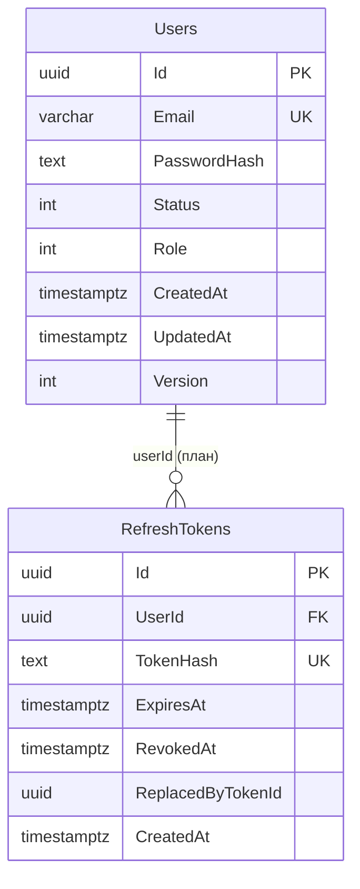
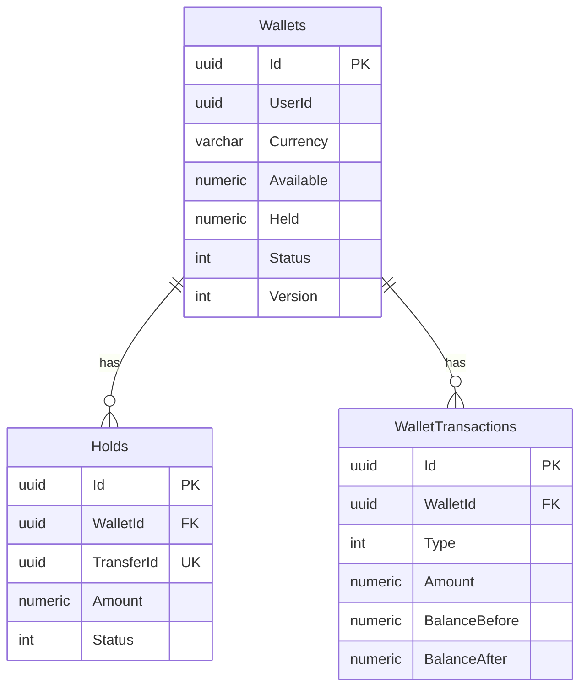
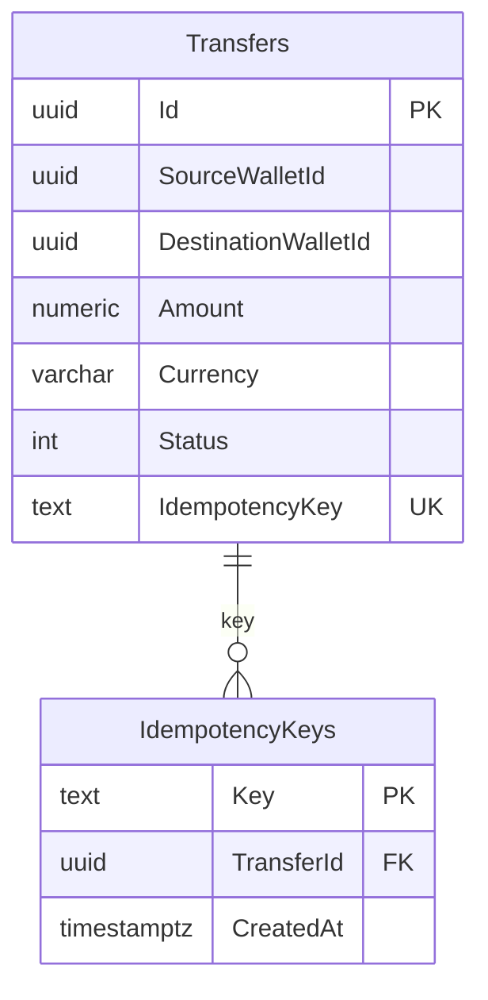

# Схема БД: текущее состояние и целевая модель

> Обновлено 31.10.2026.  
> **Источник истины по текущей схеме — EF-миграции** в `Identity/src/Otus.PaymentSystem.Identity.Infrastructure/Persistence/Migrations/`.  
> Целевая модель — [architecture.ru.md](./architecture.ru.md), раздел 6, и [bounded-contexts.md](./bounded-contexts.md).

## Легенда

| Статус | Значение |
|---|---|
| ✅ | Есть в коде и применено миграцией |
| 🟡 | Частично: есть в модели, но не в БД |
| ⬜ | План, таблицы ещё нет |

Сейчас реально создана только БД Identity. Wallets, Payments, Fraud, Notifications и Audit — целевые схемы, их миграции появятся в M2–M4.

---

## 1. Identity

### 1.1. `Users` ✅

Создана миграцией `20261030205450_InitialIdentity`.

| Колонка | Тип | Ограничения |
|---|---|---|
| `Id` | `uuid` | PK |
| `Email` | `varchar(320)` | NOT NULL, UNIQUE (`IX_Users_Email`) |
| `PasswordHash` | `text` | NOT NULL |
| `Status` | `integer` | NOT NULL, 0 = Active, 1 = Blocked |
| `Role` | `integer` | NOT NULL, 0 = User, 1 = Admin |
| `CreatedAt` | `timestamptz` | NOT NULL |
| `UpdatedAt` | `timestamptz` | NOT NULL |
| `Version` | `integer` | NOT NULL |

Особенности:

- email нормализуется value object `Email` (lowercase + trim) до записи;
- `Version` задуман под optimistic concurrency, но в `UserConfiguration` **пока не помечен** как concurrency token;
- `Roles` / `UserRoles` из старых доков **не созданы**: роль хранится enum’ом в `Users.Role`.

### 1.2. `RefreshTokens` ⬜

Появится в M1W3 (#48). Поля — из [bounded-contexts.md](./bounded-contexts.md:116).

| Колонка | Тип | Ограничения |
|---|---|---|
| `Id` | `uuid` | PK |
| `UserId` | `uuid` | FK → `Users.Id`, NOT NULL |
| `TokenHash` | `text` | NOT NULL, UNIQUE; хранится только хэш |
| `ExpiresAt` | `timestamptz` | NOT NULL |
| `RevokedAt` | `timestamptz` | NULL |
| `ReplacedByTokenId` | `uuid` | NULL, FK → `RefreshTokens.Id` |
| `CreatedAt` | `timestamptz` | NOT NULL |

Индексы:

- `IX_RefreshTokens_TokenHash` UNIQUE;
- `IX_RefreshTokens_UserId`;
- `IX_RefreshTokens_ExpiresAt` — для фоновой очистки.

Правила:

- refresh-токен ротируется: старый получает `RevokedAt` и `ReplacedByTokenId`;
- повторное использование старого токена — отказ;
- смена пароля отзывает все refresh пользователя.

---

## 2. Wallets

План M2. Целевые таблицы — [architecture.ru.md](./architecture.ru.md:225) и [bounded-contexts.md](./bounded-contexts.md:150).

### 2.1. `Wallets` ⬜

| Колонка | Тип | Ограничения |
|---|---|---|
| `Id` | `uuid` | PK |
| `UserId` | `uuid` | NOT NULL, ссылка на Identity без FK между сервисами |
| `Currency` | `varchar(3)` | NOT NULL, ISO 4217; MVP — RUB |
| `Available` | `numeric(18,4)` | NOT NULL, >= 0 |
| `Held` | `numeric(18,4)` | NOT NULL, >= 0 |
| `Status` | `integer` | NOT NULL, Active / Frozen / Closed |
| `Version` | `integer` | NOT NULL, optimistic concurrency |
| `CreatedAt` | `timestamptz` | NOT NULL |
| `UpdatedAt` | `timestamptz` | NOT NULL |

Открытый вопрос: нужен ли `UNIQUE (UserId, Currency)` в MVP (сейчас один RUB-кошелёк на пользователя).

### 2.2. `Holds` ⬜

| Колонка | Тип | Ограничения |
|---|---|---|
| `Id` | `uuid` | PK |
| `WalletId` | `uuid` | FK → `Wallets.Id` |
| `TransferId` | `uuid` | UNIQUE, идемпотентность от Payments |
| `UserId` | `uuid` | NOT NULL |
| `Amount` | `numeric(18,4)` | NOT NULL, > 0 |
| `Status` | `integer` | Active / Completed / Released / Expired |
| `CreatedAt` | `timestamptz` | NOT NULL |
| `UpdatedAt` | `timestamptz` | NOT NULL |

`UNIQUE (TransferId)` — ключевое ограничение: повторный `hold` с тем же `transferId` возвращает существующий hold.

### 2.3. `WalletTransactions` ⬜

| Колонка | Тип | Ограничения |
|---|---|---|
| `Id` | `uuid` | PK |
| `WalletId` | `uuid` | FK → `Wallets.Id` |
| `Type` | `integer` | TopUp / Withdrawal / TransferIn / TransferOut / Fee / Refund |
| `Amount` | `numeric(18,4)` | NOT NULL |
| `Currency` | `varchar(3)` | NOT NULL |
| `BalanceBefore` | `numeric(18,4)` | NOT NULL |
| `BalanceAfter` | `numeric(18,4)` | NOT NULL |
| `ReferenceId` | `uuid` | NULL, TransferId или внешняя ссылка |
| `Description` | `text` | NULL |
| `CreatedAt` | `timestamptz` | NOT NULL |

Инвариант: `BalanceAfter = BalanceBefore ± Amount`.

### 2.4. `Outbox` ⬜

Точная схема появится в M4. Минимум:

| Колонка | Тип |
|---|---|
| `Id` | `uuid` PK |
| `EventType` | `text` |
| `Payload` | `jsonb` |
| `OccurredAt` | `timestamptz` |
| `PublishedAt` | `timestamptz` NULL |

---

## 3. Payments

План M3. MVP-статусы — из [architecture.ru.md](./architecture.ru.md:228): `Created` → `Held` → `Completed` / `Failed` / `Confirming`.

> В `bounded-contexts.md` описан более поздний target со статусами `Pending/Processing/...`; для M1–M5 источник истины — `architecture.ru.md`.

### 3.1. `Transfers` ⬜

| Колонка | Тип | Ограничения |
|---|---|---|
| `Id` | `uuid` | PK |
| `SourceWalletId` | `uuid` | NOT NULL |
| `DestinationWalletId` | `uuid` | NOT NULL |
| `Amount` | `numeric(18,4)` | NOT NULL, > 0 |
| `Currency` | `varchar(3)` | NOT NULL |
| `Status` | `integer` | Created / Held / Completed / Failed / Confirming |
| `IdempotencyKey` | `text` | UNIQUE |
| `ErrorMessage` | `text` | NULL |
| `CreatedAt` | `timestamptz` | NOT NULL |
| `UpdatedAt` | `timestamptz` | NOT NULL |
| `CompletedAt` | `timestamptz` | NULL |

Точный набор полей (fee, fraud-статус) фиксируется в M3; таблица выше — минимальный контракт.

### 3.2. `IdempotencyKeys` ⬜

| Колонка | Тип | Ограничения |
|---|---|---|
| `Key` | `text` | PK |
| `TransferId` | `uuid` | NOT NULL |
| `CreatedAt` | `timestamptz` | NOT NULL |

Альтернатива — `UNIQUE (IdempotencyKey)` прямо в `Transfers`; выбор фиксируется в ADR M3.

### 3.3. `Outbox` ⬜

Аналогично Wallets: `TransferCreated`, `TransferCompleted`, `TransferFailed`.

---

## 4. Fraud

План M3. В `architecture.ru.md` — `Rules`, `FraudSettings`, `Decisions`, `Blacklist`; в `bounded-contexts.md` — `FraudRules`, `FraudAlerts`. Для MVP достаточно:

| Таблица | Назначение |
|---|---|
| `Rules` | пороги, частота, blacklist, risk score |
| `FraudSettings` | fallback-порог |
| `Decisions` | решение по transfer: Passed / Blocked + причина |
| `Blacklist` | заблокированные userId/карты/реквизиты |

Точные колонки — при реализации M3.

---

## 5. Notifications

План M4.

| Таблица | Назначение |
|---|---|
| `Templates` | шаблоны по eventType + channel + locale |
| `SentMessages` | `eventId UNIQUE`, channel, status, retryCount, sentAt |
| `UserPreferences` | каналы и opt-in |

Идемпотентность: `UNIQUE (EventId, Channel)`.

---

## 6. Audit

План M4.

`Events`:
- `Id` uuid PK;
- `EventId` uuid UNIQUE;
- `EventType` text;
- `AggregateType` text;
- `AggregateId` uuid;
- `UserId` uuid NULL;
- `CorrelationId` text NULL;
- `Payload` jsonb;
- `OccurredAt` timestamptz;
- append-only, без update/delete.

---

## 7. Redis

Не таблица, но хранилище:

- ключ `user:{userId}` → `{ "exists": true, "status": "Active" }`;
- TTL 60 секунд для существующего, 10 секунд для несуществующего;
- используется Transfers для валидации получателя (M3).

---

## 8. KYC (post-1.0)

Не PostgreSQL:

- MongoDB `kyc_cases`: `userId`, `status`, `documents[]`, `providerResult`, timestamps;
- MinIO/S3: файлы, в Mongo только `fileId`, `contentType`, `size`, `sha256`;
- gRPC — внутренний API, REST — через Gateway.

---

## 9. Соглашения

- PK — `uuid`, кроме натуральных ключей (`IdempotencyKeys.Key`).
- Время — `timestamptz` (`DateTimeOffset`).
- Деньги — `numeric(18,4)`, не `float`/`double`.
- Имена таблиц/колонок в текущей Identity — PascalCase в кавычках (`"Users"`, `"Email"`); в новых сервисах можно перейти на snake_case, но **внутри одного сервиса — единообразно**.
- Optimistic concurrency — колонка `Version` + `IsConcurrencyToken()`; в текущем `UserConfiguration` это ещё не включено.
- Межсервисных FK нет: сервисы ссылаются по `UserId`/`WalletId` без внешних ключей.

---

## 10. Открытые вопросы

1. `RefreshTokens`: SHA-256 от токена или HMAC с серверным ключом?
2. `Transfers`: отдельная `IdempotencyKeys` или `UNIQUE` в `Transfers`?
3. `Wallets`: `UNIQUE (UserId, Currency)` или несколько кошельков на валюту?
4. `Outbox`: точная схема и стратегия очистки.
5. `Roles`/`UserRoles`: оставляем enum или переходим на таблицы при появлении RBAC?
6. `Version` в `Users`: включать concurrency token сейчас или при появлении конкурентных обновлений профиля?

---

## Связанные документы

- [architecture.ru.md](./architecture.ru.md) — модели данных по сервисам, раздел 6.
- [bounded-contexts.md](./bounded-contexts.md) — агрегаты и поля.
- [roadmap.ru.md](./roadmap.ru.md) — когда появляются Wallets/Payments/Fraud/Notifications/Audit.
- [Identity README](../Identity/README.md) — локальная БД и миграции.
