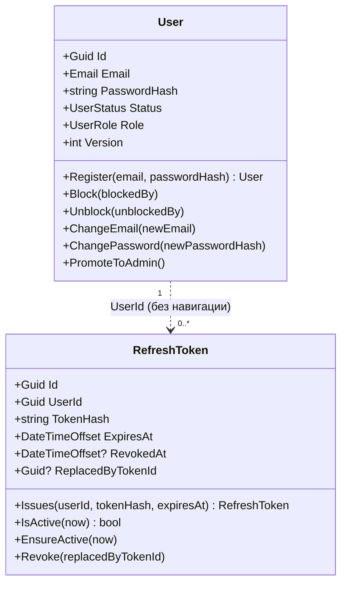
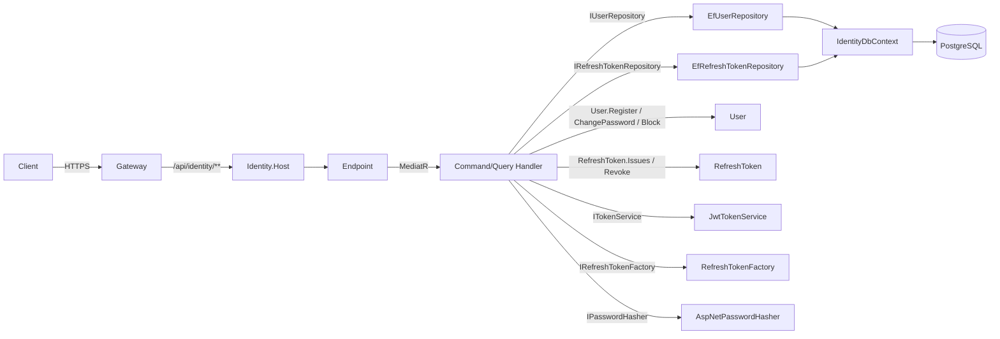
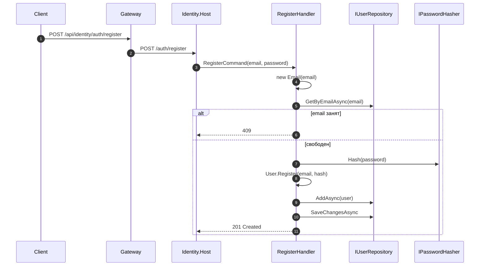
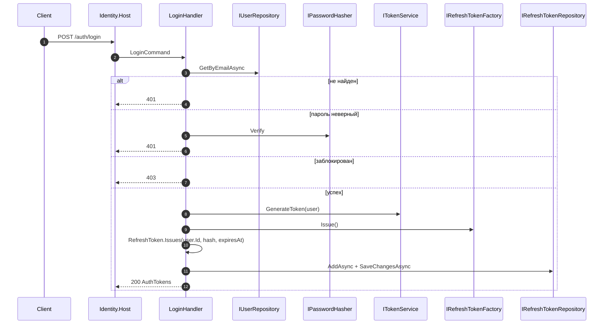
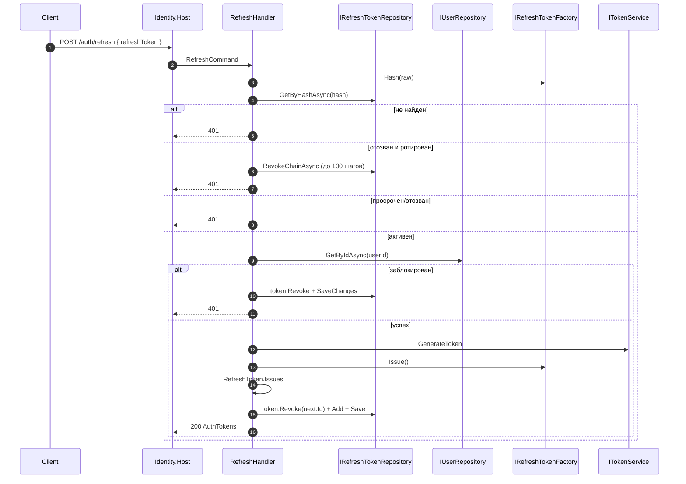
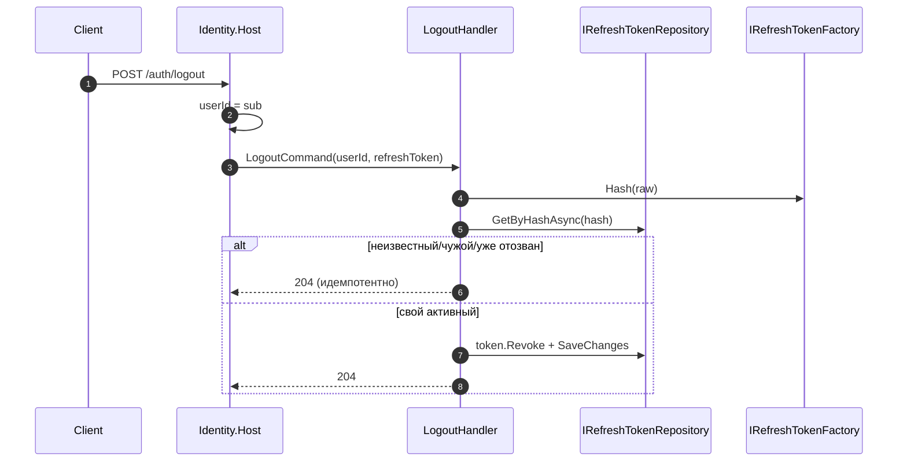
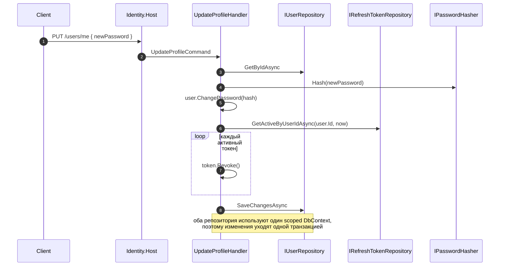

# Identity: взаимодействие сущностей, инициализация и вызовы

> **Статус:** описание текущей реализации Identity (M1). Документ фиксирует, кто создаёт сущности, кто и какие методы вызывает, как это связано с EF Core, DI, Host и Gateway.
>
> **Связанные документы:** [architecture.ru.md](./architecture.ru.md) · [db-schema.ru.md](./db-schema.ru.md) · [auth-requirements.ru.md](./auth-requirements.ru.md) · [api-contracts.ru.md](./api-contracts.ru.md) · [testing-strategy.ru.md](./testing-strategy.ru.md)

## 1. Зачем этот документ

Код показывает, **что** делает каждая сущность, но не показывает, **кто и когда её создаёт**, **кто имеет право вызывать её методы** и **как запрос доходит от Gateway до агрегата**. В Identity это особенно важно из-за двух независимых жизненных циклов — пользователя и refresh-токена — и из-за того, что блокировка, смена пароля и reuse-детект затрагивают сразу несколько таблиц.

## 2. Границы агрегатов

В Identity **два агрегатных корня**:

- `User` — пользователь, его email, пароль, статус и роль.
- `RefreshToken` — отдельная сущность со своим жизненным циклом, ротацией и цепочкой отзыва.

`RefreshToken` не является частью агрегата `User`: у `User` нет навигации на токены, токены живут в отдельном репозитории. Это сделано осознанно:

- токен можно отозвать, не загружая пользователя;
- ротация и reuse-детект — отдельная операция;
- `UpdateProfile` отзывает токены через репозиторий, а не через коллекцию внутри `User`;
- FK `RefreshTokens.UserId → Users.Id` существует только на уровне БД, не в объектной модели.

Правила границы:

1. `User` создаётся только через `User.Register`; конструкторы `private`.
2. `RefreshToken` создаётся только через `RefreshToken.Issues`; конструкторы `private`.
3. `Email` — value object, валидируется в конструкторе.
4. Пароль в Domain попадает уже хэшем: `User.Register` и `User.ChangePassword` не знают про PBKDF2.
5. `User.Version` увеличивается в `Touch`, но **не** является concurrency token в EF (см. раздел 6).

## 3. Кто инициализирует сущности

| Объект | Публичная точка входа | Кто вызывает | Кто ещё может создать | Запрещено |
|---|---|---|---|---|
| `User` | `User.Register(email, passwordHash)` | `RegisterCommandHandler`, `DevAdminSeeder` | EF Core — через `private User()` | `new User(...)` вне `Domain` |
| `RefreshToken` | `RefreshToken.Issues(userId, tokenHash, expiresAt)` | `LoginCommandHandler`, `RefreshCommandHandler` | EF Core — через `private RefreshToken()` | `new RefreshToken(...)` вне `Domain` |
| `Email` | `new Email(value)` | Handler'ы, `DevAdminSeeder`, EF-конвертер | — | Передача непровалидированной строки в `User.Email` |
| Хэш пароля | `IPasswordHasher.Hash(password)` | `RegisterCommandHandler`, `UpdateProfileCommandHandler`, `DevAdminSeeder` | — | Хэширование в Domain |
| Access-токен | `ITokenService.GenerateToken(user)` | `LoginCommandHandler`, `RefreshCommandHandler` | — | Генерация JWT в Domain |
| Refresh-токен (raw + hash) | `IRefreshTokenFactory.Issue()` / `Hash(raw)` | `LoginCommandHandler`, `RefreshCommandHandler`, `LogoutCommandHandler` | — | Хранение raw-токена в БД |
| `IdentityDbContext` | DI: `AddDbContext<IdentityDbContext>` | Host/DI | Тесты — через `new` с `DbContextOptions` | Создание в handler'е вручную |
| `IdentitySigningKey` | DI: singleton, создаётся в `Program` | Host/DI | — | Создание ключа в handler'е |
| `RegisterCommandHandler` | MediatR `Send` | `POST /auth/register` | DI/MediatR | Прямой вызов из другого handler'а |
| `LoginCommandHandler` | MediatR `Send` | `POST /auth/login` | DI/MediatR | Прямой вызов из endpoint'а в обход MediatR |
| `DevAdminSeeder` | `SeedAsync` | `Program` (только Development) | — | Запуск в Production |

## 4. Кто кого вызывает

### 4.1. Целевая цепочка запроса

### 4.2. Матрица вызовов

| Вызывающий | Вызываемый | Когда | Побочные эффекты |
|---|---|---|---|
| Endpoint | MediatR `Send` | На каждый HTTP-запрос | Нет; только маршрутизация в handler |
| `RegisterCommandHandler` | `IUserRepository.GetByEmailAsync` | До хэширования | Проверка уникальности email |
| `RegisterCommandHandler` | `IPasswordHasher.Hash` | После проверки email | PBKDF2-хэш |
| `RegisterCommandHandler` | `User.Register` | После хэширования | `UserRegistered`; `Status = Active`, `Role = User`, `Version = 0` |
| `RegisterCommandHandler` | `IUserRepository.AddAsync` / `SaveChangesAsync` | После создания | `INSERT Users` |
| `LoginCommandHandler` | `IUserRepository.GetByEmailAsync` | Первым шагом | `null` → `401` |
| `LoginCommandHandler` | `IPasswordHasher.Verify` | После поиска | `false` → `401` |
| `LoginCommandHandler` | `ITokenService.GenerateToken` | После проверки статуса | JWT с `sub/email/jti/role` |
| `LoginCommandHandler` | `IRefreshTokenFactory.Issue` | После access-токена | `Raw` клиенту, `Hash` в БД |
| `LoginCommandHandler` | `RefreshToken.Issues` | После `Issue` | Новый refresh-токен |
| `LoginCommandHandler` | `IRefreshTokenRepository.AddAsync` / `SaveChangesAsync` | После создания | `INSERT RefreshTokens` |
| `RefreshCommandHandler` | `IRefreshTokenFactory.Hash` | Первым шагом | SHA-256 предъявленного токена |
| `RefreshCommandHandler` | `IRefreshTokenRepository.GetByHashAsync` | После хэширования | `null` → `401` |
| `RefreshCommandHandler` | `RefreshToken.EnsureActive` | Если токен не отозван | Истёк → `401` |
| `RefreshCommandHandler` | `IUserRepository.GetByIdAsync` | После проверки токена | `null` → `401` |
| `RefreshCommandHandler` | `RefreshToken.Revoke(next.Id)` | При ротации | `RevokedAt` + `ReplacedByTokenId` |
| `RefreshCommandHandler` | `RevokeChainAsync` | При reuse | Отзыв цепочки до 100 шагов |
| `LogoutCommandHandler` | `IRefreshTokenFactory.Hash` | Первым шагом | SHA-256 |
| `LogoutCommandHandler` | `IRefreshTokenRepository.GetByHashAsync` | После хэширования | `null`/чужой/отозванный → `204` |
| `LogoutCommandHandler` | `RefreshToken.Revoke` | Для своего активного токена | `RevokedAt` |
| `UpdateProfileCommandHandler` | `IUserRepository.GetByIdAsync` | Первым шагом | `null` → `404` |
| `UpdateProfileCommandHandler` | `User.ChangeEmail` | Если `NewEmail` задан | `EmailChanged`; проверка уникальности в handler'е |
| `UpdateProfileCommandHandler` | `IPasswordHasher.Hash` + `User.ChangePassword` | Если `NewPassword` задан | `PasswordChanged` |
| `UpdateProfileCommandHandler` | `IRefreshTokenRepository.GetActiveByUserIdAsync` | При смене пароля | Список активных токенов |
| `UpdateProfileCommandHandler` | `RefreshToken.Revoke` (для каждого) | При смене пароля | Все сессии завершаются |
| `BlockUserCommandHandler` | `User.Block` | Блокировка админом | `UserBlocked`; `Status = Blocked` |
| `UnblockUserCommandHandler` | `User.Unblock` | Разблокировка админом | `UserUnblocked`; `Status = Active` |
| `AuthEndpoints.Me` | ClaimsPrincipal | `GET /auth/me` | Без БД |
| `DevAdminSeeder` | `User.Register` / `PromoteToAdmin` | Старт в Development | Создание/повышение админа |
| EF Core | `private User()` / `private RefreshToken()` | Материализация | Инварианты **не** выполняются |
| Gateway | `GET /.well-known/jwks.json` | Старт и обновление ключей | Кэш JWKS на 10 минут |

### 4.3. Что handler НЕ делает

- Не создаёт `User`/`RefreshToken` вручную (`new`).
- Не меняет `Status`/`Role`/`PasswordHash` напрямую.
- Не хранит raw refresh-токен в БД: только `Hash`.
- Не вызывает `SaveChanges` до завершения доменной операции (кроме reuse-детекта, где это осознанно).
- Не доверяет `userId` из тела: для `/users/me` он берётся из `sub`.

## 5. Сценарии

### 5.1. Регистрация

Ошибки: `400` — невалидный email/пароль; `409` — email занят. Гонка двух регистраций с одним email ловится уникальным индексом `IX_Users_Email`, но `DbUpdateException` сейчас не маппится в `409` (см. раздел 10).

### 5.2. Логин

### 5.3. Refresh и reuse-детект

Ключевое правило: **ротация и reuse-детект живут в Application, а не в Domain.** `RefreshToken` знает только `Revoke`/`IsActive`; цепочку обходит handler.

### 5.4. Logout

### 5.5. Смена пароля и отзыв сессий

## 6. EF Core: материализация и конфигурация

| Сущность | Таблица | Ключевые настройки |
|---|---|---|
| `User` | `Users` | `Email` → `varchar(320)` + UNIQUE; `Status`/`Role` → `int`; `Version` — `int`, **не** concurrency token |
| `RefreshToken` | `RefreshTokens` | `TokenHash` UNIQUE; `UserId` FK → `Users.Id` (cascade); `ReplacedByTokenId` self-FK (restrict); индексы `UserId`, `ExpiresAt` |

Миграции: `20261030205450_InitialIdentity`, `20261103210320_AddRefreshTokens`.

EF Core — единственный, кто создаёт сущности в обход фабрик:

1. `IdentityDbContext.Users` → `private User()` → поля из колонок.
2. `IdentityDbContext.RefreshTokens` → `private RefreshToken()`.
3. `Email` конвертируется через `HasConversion`: строка ↔ `new Email(value)`.
4. `User.DomainEvents` не маппится и при загрузке пуст.
5. `RefreshToken.RevokedAt`/`ReplacedByTokenId` — nullable.

`EfUserRepository` и `EfRefreshTokenRepository` получают один и тот же scoped `IdentityDbContext`:

- `UpdateProfileCommandHandler` меняет `User` и отзывает `RefreshToken`, затем делает один `SaveChangesAsync` — обе таблицы в одной транзакции;
- `LoginCommandHandler` и `RefreshCommandHandler` сохраняют refresh-токен отдельным `SaveChangesAsync`;
- отдельного `IUnitOfWork` нет: его роль выполняет scoped `DbContext`.

## 7. DI, Host и Gateway

| Сервис | Lifetime | Почему |
|---|---|---|
| `IdentityDbContext` | Scoped | Один экземпляр на HTTP-запрос |
| `IUserRepository` / `EfUserRepository` | Scoped | Работают с `DbContext` запроса |
| `IRefreshTokenRepository` / `EfRefreshTokenRepository` | Scoped | То же |
| `PasswordHasher<object>` | Singleton | Не хранит состояние |
| `IPasswordHasher` / `AspNetPasswordHasher` | Scoped | Оборачивает singleton |
| `ITokenService` / `JwtTokenService` | Scoped | Зависит от options и ключа |
| `IRefreshTokenFactory` / `RefreshTokenFactory` | Scoped | Зависит от options |
| `IdentitySigningKey` | Singleton | Ключ один на процесс; в Development — эфемерный |
| MediatR handlers | Transient | Создаются на запрос |

`Program.cs`:

- `AddIdentityInfrastructure` — `DbContext`, репозитории, hasher, token service, refresh factory, options;
- `AddMediatR` — все handler'ы из `Application`;
- `AddAuthentication(JwtBearer)` — RS256 по `IdentitySigningKey.PublicKey`, `MapInboundClaims = false`;
- `AddAuthorization` — policy `AdminOnly` (claim `role = Admin`);
- `AddApiProblems`, Swagger, Serilog, валидаторы;
- `Database:AutoMigrate` — миграции на старте только по флагу;
- `DevAdminSeeder` — только Development.

Порядок middleware: correlation → Serilog → `UnhandledExceptionMiddleware` → `EmptyResponseProblemMiddleware` → Swagger → `DomainExceptionMiddleware` → auth → endpoints.

### 7.1. Эндпоинты и политики

| Метод и путь | Политика | Handler | Успех | Ошибки |
|---|---|---|---|---|
| `POST /auth/register` | anonymous | `RegisterCommand` | `201` | `400`, `409` |
| `POST /auth/login` | anonymous | `LoginCommand` | `200` | `400`, `401`, `403` |
| `GET /auth/me` | authenticated | claims | `200` | `401` |
| `POST /auth/logout` | authenticated | `LogoutCommand` | `204` | `400`, `401` |
| `POST /auth/refresh` | anonymous | `RefreshCommand` | `200` | `400`, `401` |
| `GET /users/me` | authenticated | `GetProfileQuery` | `200` | `401`, `404` |
| `PUT /users/me` | authenticated | `UpdateProfileCommand` | `204` | `400`, `401`, `404`, `409` |
| `GET /users/{id}` | `AdminOnly` | `GetProfileQuery` | `200` | `401`, `403`, `404` |
| `POST /users/{id}/block` | `AdminOnly` | `BlockUserCommand` | `204` | `401`, `403`, `404`, `409` |
| `POST /users/{id}/unblock` | `AdminOnly` | `UnblockUserCommand` | `204` | `401`, `403`, `404`, `409` |
| `GET /health` | anonymous | — | `200` | — |
| `GET /.well-known/jwks.json` | anonymous | `IdentitySigningKey` | `200` | — |

### 7.2. JWT, JWKS и Gateway

- Identity подписывает access-токены **RS256** ключом `IdentitySigningKey`.
- Claims: `sub` (UserId), `email`, `jti`, `role`; issuer/audience из `JwtOptions`.
- `IdentitySigningKey` в Development генерируется эфемерно, в остальных окружениях требует `Jwt:PrivateKeyPem`.
- `GET /.well-known/jwks.json` отдаёт публичный ключ; `kid` — первые 16 hex SHA-256 публичного ключа.
- Gateway проверяет JWT локально по JWKS, кэширует ключи на 10 минут и обновляет кэш при неизвестном `kid`.
- Gateway маршрутизирует `/api/identity/**` в Identity, добавляет `X-User-Id` из `sub` и удаляет клиентский `X-User-Id`.
- **Identity не использует `X-User-Id`**: он валидирует JWT сам и берёт `sub` из `ClaimsPrincipal`. `X-User-Id` нужен внутренним сервисам (Payments/Wallets) в MVP.
- `/bff/me` собирает `sub/email/role` из токена без похода в Identity; `/bff/health` синхронно вызывает `GET /health` Identity.

## 8. Статусы и роли

### 8.1. UserStatus

| Из | В | Метод | Условие |
|---|---|---|---|
| Active | Blocked | `Block` | не заблокирован |
| Blocked | Active | `Unblock` | заблокирован |
| любое | — | `ChangeEmail`, `ChangePassword` | доступно и активному, и заблокированному |

Эффекты блокировки:

- `POST /auth/login` → `403`;
- `POST /auth/refresh` → токен отзывается, `401`;
- уже выданный access-токен **не отзывается** и живёт до `exp` — известное ограничение JWT.

### 8.2. UserRole

| Роль | Как появляется | Права |
|---|---|---|
| `User` | `User.Register` | свои `/users/me`, `/auth/me` |
| `Admin` | `PromoteToAdmin` (только `DevAdminSeeder`) | `GET /users/{id}`, `block`/`unblock` |

Политика `AdminOnly` проверяет claim `role = Admin`.

### 8.3. RefreshToken

| Состояние | Признак | Что делает |
|---|---|---|
| Active | `RevokedAt == null` и `ExpiresAt > now` | можно ротировать |
| Revoked (logout) | `RevokedAt != null`, `ReplacedByTokenId == null` | `401` |
| Rotated | `RevokedAt != null` и `ReplacedByTokenId != null` | `401` + отзыв цепочки |
| Expired | `ExpiresAt <= now` | `401` |

## 9. Ownership и авторизация

- `/auth/me` — данные из claims, без БД; `/users/me` — профиль из БД по `sub`.
- `/users/{id}` — только `Admin`; обычный пользователь получает `403`.
- `/users/{id}/block`, `unblock` — только `Admin`.
- `401` — нет/невалиден токен; `403` — токен есть, но нет роли/пользователь заблокирован; `404` — пользователь не найден.
- `X-User-Id` от Gateway **не** является доказательством личности для Identity: Identity всегда проверяет JWT.
- В MVP нет service-to-service аутентификации: внутренние сервисы доверяют `X-User-Id` внутри сети. Это известный security-долг.

## 10. Текущее состояние и пробелы

| Слой | Состояние |
|---|---|
| Domain | `User`, `RefreshToken`, `Email`, события, ошибки — готовы |
| Application | команды/запросы, handler'ы, порты — готовы |
| Infrastructure | EF, репозитории, JWT/RS256, refresh factory, hasher, миграции — готовы |
| Host | endpoints, middleware, Swagger, JWT bearer, seeder — готовы |
| Tests | Domain/Application/Host/Infrastructure; Postgres-тесты отдельным job |

Известные ограничения:

1. **Доменные события не публикуются.** `UserRegistered`, `UserBlocked`, `PasswordChanged` и др. накапливаются в `DomainEvents`, но `ClearDomainEvents` вызывается только в тестах; outbox/публикации нет. Architecture прямо говорит, что Identity в MVP событий не публикует — это осознанно, но код уже содержит заготовки.
2. **`User.Version` не concurrency token.** В `UserConfiguration` только `IsRequired()`; параллельные `PUT /users/me` могут перезаписать изменения.
3. **Гонка регистрации.** Проверка email и `INSERT` не атомарны; уникальный индекс `IX_Users_Email` вернёт `DbUpdateException`, который не маппится в `409`.
4. **Блокировка не отзывает сессии сразу.** Refresh-токены отзываются только при следующем `refresh`; access-токен живёт до `exp`.
5. **`Location` при регистрации.** `Results.Created("/users/{id}")` возвращает путь без `/api/identity`; через Gateway он может вести не туда.
6. **`JwtOptions.Secret`** остался в конфиге, но не используется после перехода на RS256.
7. **Очистка refresh-токенов.** Нет фоновой очистки истёкших/отозванных токенов; цепочка reuse ограничена 100 шагами.
8. **Service-to-service auth** отсутствует; `X-User-Id` доверяется внутри сети.
9. **Rate limiting** login/refresh живёт на Gateway, не в Identity.
10. **Rehash пароля** (`SuccessRehashNeeded`) принимается, но новый хэш не сохраняется.

## 11. Чек-лист для ревью

- [ ] `User` создаётся только через `User.Register`; `RefreshToken` — только через `Issues`.
- [ ] Handler'ы не меняют `Status`/`Role`/`PasswordHash` напрямую.
- [ ] Raw refresh-токен не хранится в БД; только SHA-256.
- [ ] Login проверяет пароль и статус; blocked → `403`.
- [ ] Refresh ротирует токен и отзывает цепочку при reuse.
- [ ] Logout идемпотентен и не отзывает чужой токен.
- [ ] Смена пароля отзывает все активные refresh-токены.
- [ ] Email uniqueness проверяется до `INSERT` и подкреплена уникальным индексом.
- [ ] `/users/{id}`, `block`, `unblock` защищены `AdminOnly`.
- [ ] `401`/`403`/`404` различимы и покрыты тестами.
- [ ] Gateway проверяет JWT по JWKS и не пропускает клиентский `X-User-Id`.

## 12. Общие правила, применимые к Identity

- **JWT:** Identity выпускает токены; Gateway и сервисы валидируют их по JWKS. Для новых сервисов — [ADR 0005](./adr/0005-jwt-validation-in-services.md), без OIDC-discovery.
- **DTO:** результаты handler'ов — в `Application` (`RegisterResult`, `GetProfileResult`, `AuthTokens`); HTTP-запросы — в `Host/Contracts`.
- **DomainError:** `Validation→400`, `Unauthorized→401`, `Forbidden→403`, `NotFound→404`, `Conflict→409`.
- **IUnitOfWork:** не вводится; `IUserRepository`/`IRefreshTokenRepository` работают с одним scoped `IdentityDbContext`, транзакция — через `SaveChangesAsync`.
- **Миграции:** Identity использует Host как startup-project; для сервиса без готового Host — `IDesignTimeDbContextFactory<T>` в Infrastructure.
- **Эндпоинты:** extension-методы `MapAuthEndpoints()`/`MapUsersEndpoints()`; `Program.cs` только вызывает их и `/health`.
- Общие правила для всех сервисов: [project-guide.ru.md](./project-guide.ru.md), раздел 6.6.
