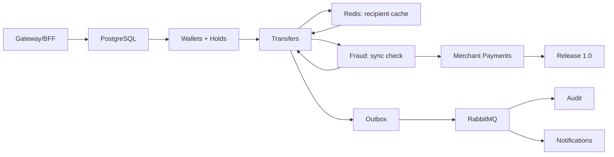

# Otus Payment System — Roadmap

> **Current as of 2026-10-30.** The new baseline starts on Monday **2026-11-02**.
> October 2026 is recorded as **M0 (actuals)** and is not stretched into November.
>
> Related: [ADR 0001 — API Gateway](./adr/0001-api-gateway.md) · [Architecture](./architecture.md) · [Bounded contexts](./bounded-contexts.md) · [Auth requirements](./auth-requirements.en.md)
>
> Board dashboard: [#70](https://github.com/PoyarkinES/otus_payment_system/issues/70)

## 1. Why the plan was rebuilt

The old roadmap assumed a clean month-by-month progression. Reality was different:

- **Identity is ahead.** Registration, login, JWT, roles, profile, block/unblock, and tests were completed by 21 October.
- **PostgreSQL and infrastructure are missing.** PostgreSQL, migrations, Docker, structured logging, and CI tests are not done; as a result, Wallets and the following phases shift by about a month.
- **The Gateway was never planned.** The old roadmap only had a Payment Gateway (merchant acquiring), not the edge/BFF between the frontend and the services.
- **The board had no months, weeks, or order.** Ten first-month tasks were open without milestones or dependencies.

The new plan follows the critical path:

```
Gateway → PostgreSQL → Wallets → Transfers → Outbox/RabbitMQ → Audit/Notifications → Fraud → Merchant Payments → Release 1.0
```

## 2. Actual state on 2026-10-30 (M0)

| Area | Status | Comment |
|---|---|---|
| Repository scaffold, per-context solutions | ✅ Done | 7 solutions, `src`/`test`, SharedKernel |
| Architecture, bounded contexts, auth docs | ✅ Done | #15, #18, #23 |
| Identity MVP | ✅ Done | #12: register/login/JWT, `/auth/me`, profile, block/unblock, roles |
| Identity unit tests | ✅ Present | Domain/Application/Infrastructure/Host |
| CI | 🟡 Partial | Builds solutions, **does not run tests** |
| PostgreSQL + migrations | ❌ Missing | Identity uses EF InMemory, #10 |
| Refresh/logout, rate limiting | ❌ Missing | Requirements exist, implementation does not |
| API Gateway / BFF | ❌ Missing | Was not in the old plan |
| Docker Compose | ❌ Missing | No PostgreSQL, RabbitMQ, or full stack |
| Wallets/Transfers/Fraud/Notifications/Audit | ⚪ Scaffold | Domain events only |

**Conclusion:** Identity is done and partly ahead of the old plan, but PostgreSQL and the Gateway are missing. Wallets and the following phases therefore shift by a month: October becomes M0, and the six-month core plan starts in November.

## 3. Plan principles

1. Critical path first; no Kubernetes or Event Sourcing before the core works. Redis appears only for recipient validation in M3, not as a general cache.
2. Vertical slices: every week ends with something runnable.
3. One public entry point: the frontend talks only to Gateway/BFF.
4. Contracts before implementation.
5. Tests are part of Definition of Done, not an afterthought.
6. Every fourth week is a buffer/polish week.
7. WIP ≤ 2.
8. A month closes by exit criteria, not by calendar date.

## 4. Programme at a glance

| Month | Dates | Goal | Epic | Outcome |
|---|---|---|---|---|
| **M1** | 2–29 Nov 2026 | Edge & Foundation: Gateway/BFF, PostgreSQL, Identity hardening | [#40](https://github.com/PoyarkinES/otus_payment_system/issues/40) | One entry point; Identity in PostgreSQL; refresh/logout; CI runs tests |
| **M2** | 30 Nov – 27 Dec 2026 | Wallets: balances, holds, operations | [#41](https://github.com/PoyarkinES/otus_payment_system/issues/41) | `available`/`held`, top-up/withdraw, hold/confirm/release, history, optimistic locking |
| **M3** | 28 Dec 2026 – 24 Jan 2027 | Transfers: idempotency, Redis, hold, Fraud sync | [#42](https://github.com/PoyarkinES/otus_payment_system/issues/42) | Safe transfer + `Confirming` + audit + outbox |
| **M4** | 25 Jan – 21 Feb 2027 | Async: RabbitMQ, Audit, Notifications | [#43](https://github.com/PoyarkinES/otus_payment_system/issues/43) | Payments/Wallets events, at-least-once, retry/DLQ |
| **M5** | 22 Feb – 21 Mar 2027 | Fraud: rules, fallback, alerts | [#44](https://github.com/PoyarkinES/otus_payment_system/issues/44) | Sync block before confirm + fallback when Fraud is down |
| **M6** | 22 Mar – 18 Apr 2027 | Merchant Payments + Release 1.0 | [#45](https://github.com/PoyarkinES/otus_payment_system/issues/45) | API keys, payments, webhooks, refunds, release |
| **M7** | 19 Apr – 23 May 2027 | **Post-1.0:** KYC/Onboarding — MongoDB, MinIO, gRPC | [#73](https://github.com/PoyarkinES/otus_payment_system/issues/73) | Synthetic document → MinIO, metadata → Mongo, status over gRPC, Payments threshold |
| **M8** | 24 May – 20 Jun 2027 | **Post-1.0:** Mobile MVP — auth, wallet, transfers, push | [#81](https://github.com/PoyarkinES/otus_payment_system/issues/81) | Mobile client via Gateway/BFF; push and biometrics |

**Total:** 24 weeks of core development (M1–M6) + 5 post-1.0 weeks (M7) + 4 mobile weeks (M8). **Web UI runs in parallel with M2–M6 and ships with 1.0**; it is not post-1.0.

**Team:** 3 people: 2 backend + 1 frontend. M7/M8 can run in parallel with core if someone is free, but **KYC/Mobile must not block 1.0**; they are behind a feature flag / separate app.

### 4.1 UI track: Web and Mobile

With a dedicated frontend developer, UI cannot wait until after 1.0 — otherwise they are idle while backend builds Wallets/Transfers.

- **Web MVP** runs in parallel with M2–M6 and ships with release 1.0.
- **Mobile MVP** is M8, after 1.0 and KYC; push needs a backend extension in Notifications.

| Track | When | Epic | Tasks |
|---|---|---|---|
| **Web** | M2–M6, parallel to backend | [#80](https://github.com/PoyarkinES/otus_payment_system/issues/80) | [#82](https://github.com/PoyarkinES/otus_payment_system/issues/82)–[#89](https://github.com/PoyarkinES/otus_payment_system/issues/89) |
| **Mobile** | M8, post-1.0 | [#81](https://github.com/PoyarkinES/otus_payment_system/issues/81) | [#90](https://github.com/PoyarkinES/otus_payment_system/issues/90)–[#93](https://github.com/PoyarkinES/otus_payment_system/issues/93) + push backend [#94](https://github.com/PoyarkinES/otus_payment_system/issues/94) |

**UI rules:**

- The client talks **only to Gateway/BFF**; direct Identity/Wallets/Payments URLs are forbidden.
- Contract is OpenAPI/BFF; generate the client from OpenAPI, avoid hand-written DTO duplication.
- Frontend chooses the stack; React/TS + Vite is the default for web, recorded in README.
- Until endpoints exist, use mocks, but agree contracts first.
- Web: login/register, profile, wallet, operations, transfer, errors, E2E smoke.
- Mobile: auth + secure storage, wallet, transfer, push/biometrics/offline.
- Security: no refresh token in localStorage; mobile uses Keychain/Keystore; no PII in logs.

**Dependencies:**

| Web task | Needs backend |
|---|---|
| Skeleton/API client | Gateway + `/health`, M1 |
| Auth/profile | login/refresh, `/bff/me`, M1W3–W4 |
| Wallet | `/bff/wallets`, M2W7 |
| Transfer | `/bff/transfers`, M3W12 |
| KYC upload | KYC M7W26–W27 |

**Risks:** OpenAPI drift, BFF delay, CORS, mobile push backend. Mitigation: contract-first, mock server, E2E via Gateway.

## 5. Weeks

| Week | Dates | Focus | Issue |
|---|---|---|---|
| W1 | 2–8 Nov | Gateway skeleton, routes, JWT, `X-User-Id`, CORS | [#46](https://github.com/PoyarkinES/otus_payment_system/issues/46) |
| W2 | 9–15 Nov | PostgreSQL for Identity, migrations, Testcontainers | [#47](https://github.com/PoyarkinES/otus_payment_system/issues/47) |
| W3 | 16–22 Nov | Refresh/logout, RSA/JWKS for Gateway, rate limiting, ProblemDetails, Serilog | [#48](https://github.com/PoyarkinES/otus_payment_system/issues/48) |
| W4 | 23–29 Nov | BFF `/bff/me`, `GET /users/{id}` for ACL, CI tests, Docker Compose, retro | [#49](https://github.com/PoyarkinES/otus_payment_system/issues/49) |
| W5 | 30 Nov – 6 Dec | Wallet aggregate (`available`/`held`), `Holds` schema, create/get | [#50](https://github.com/PoyarkinES/otus_payment_system/issues/50) |
| W6 | 7–13 Dec | Top-up/withdraw, ledger, optimistic locking | [#51](https://github.com/PoyarkinES/otus_payment_system/issues/51) |
| W7 | 14–20 Dec | Hold/confirm/release, auto-create recipient wallet, history, ownership, BFF | [#52](https://github.com/PoyarkinES/otus_payment_system/issues/52) |
| W8 | 21–27 Dec | Integration tests (hold/confirm/release concurrency), demo, retro | [#53](https://github.com/PoyarkinES/otus_payment_system/issues/53) |
| W9 | 28 Dec – 3 Jan | Transfer aggregate, idempotency, Redis + Identity validation, create + hold | [#54](https://github.com/PoyarkinES/otus_payment_system/issues/54) |
| W10 | 4–10 Jan | Fraud sync, confirm/release, `Completed`/`Failed`/`Confirming` | [#55](https://github.com/PoyarkinES/otus_payment_system/issues/55) |
| W11 | 11–17 Jan | Audit, Repository/UoW, outbox `TransferCompleted`/`TransferFailed` | [#56](https://github.com/PoyarkinES/otus_payment_system/issues/56) |
| W12 | 18–24 Jan | Integration tests, E2E, retro | [#57](https://github.com/PoyarkinES/otus_payment_system/issues/57) |
| W13 | 25–31 Jan | RabbitMQ, topology, outbox publisher (Payments + Wallets) | [#58](https://github.com/PoyarkinES/otus_payment_system/issues/58) |
| W14 | 1–7 Feb | Audit Service (Payments/Wallets events) | [#59](https://github.com/PoyarkinES/otus_payment_system/issues/59) |
| W15 | 8–14 Feb | Notifications Service (email via Identity) | [#60](https://github.com/PoyarkinES/otus_payment_system/issues/60) |
| W16 | 15–21 Feb | Resilience, observability, event-flow tests | [#61](https://github.com/PoyarkinES/otus_payment_system/issues/61) |
| W17 | 22–28 Feb | Fraud rules, `/fraud/check`, `/fraud/settings` | [#62](https://github.com/PoyarkinES/otus_payment_system/issues/62) |
| W18 | 1–7 Mar | Velocity, decisions/alerts, admin API | [#63](https://github.com/PoyarkinES/otus_payment_system/issues/63) |
| W19 | 8–14 Mar | Blacklist, risk scoring, fallback threshold | [#64](https://github.com/PoyarkinES/otus_payment_system/issues/64) |
| W20 | 15–21 Mar | Fraud tests, latency, retro | [#65](https://github.com/PoyarkinES/otus_payment_system/issues/65) |
| W21 | 22–28 Mar | Merchant, API keys, payment creation | [#66](https://github.com/PoyarkinES/otus_payment_system/issues/66) |
| W22 | 29 Mar – 4 Apr | Payment lifecycle, webhooks | [#67](https://github.com/PoyarkinES/otus_payment_system/issues/67) |
| W23 | 5–11 Apr | Refunds, payment links, docs | [#68](https://github.com/PoyarkinES/otus_payment_system/issues/68) |
| W24 | 12–18 Apr | Observability, load, security, release | [#69](https://github.com/PoyarkinES/otus_payment_system/issues/69) |

## 6. M7. KYC/Onboarding — post-1.0 (19 Apr – 23 May 2027)

**Goal:** add identity verification as a separate supporting context without destabilising release 1.0.

**Why post-1.0:** KYC is not required for a basic transfer, but it is required for higher limits, merchant onboarding, and a realistic fintech story. It is also a safe place to use MongoDB, MinIO, and gRPC without touching the money path.

**What we build:**

- new `Kyc/` bounded context;
- KYC case metadata in MongoDB;
- document files in MinIO (S3-compatible), not in Mongo or PostgreSQL;
- gRPC `GetKycStatus` / `WatchKycStatus` for internal callers;
- REST upload/status via Gateway for the frontend;
- Payments checks KYC status above a threshold behind a feature flag;
- audit, encryption, retention, no PII in logs;
- **synthetic documents only** in dev/demo.

**Why it is justified:**

| Technology | Problem | Solution |
|---|---|---|
| MongoDB | Different document types and provider payloads, flexible schema | Document model `KycCase` |
| MinIO/S3 | Scans are binary objects and should not live in the database | Private bucket, signed URL, lifecycle |
| gRPC | Internal services need a typed, low-latency contract | `.proto`, `GetKycStatus`, deadlines |

**Team of 3:**

| Role | Responsibility |
|---|---|
| A | KYC domain, Mongo, status workflow, verification stub |
| B | MinIO/S3, upload pipeline, files, encryption, security |
| C | gRPC contract, Gateway/Identity/Payments integration, observability |
| All | Contracts and threat model in W25, cross-review |

**Why it fits:** 5 weeks on a separate track, 3 people, contracts fixed in W25, no UI. If time runs out — cut `WatchKycStatus`/streaming and admin UI, never security.

| Week | Dates | Focus | Issue |
|---|---|---|---|
| W25 | 19–25 Apr | ADR 0002/0003, contracts, Mongo, MinIO, domain | [#74](https://github.com/PoyarkinES/otus_payment_system/issues/74) |
| W26 | 26 Apr – 2 May | Document upload, MinIO, verification | [#75](https://github.com/PoyarkinES/otus_payment_system/issues/75) |
| W27 | 3–9 May | gRPC contract, Payments/Identity integration | [#76](https://github.com/PoyarkinES/otus_payment_system/issues/76) |
| W28 | 10–16 May | Security, tests, audit | [#77](https://github.com/PoyarkinES/otus_payment_system/issues/77) |
| W29 | 17–23 May | Buffer, demo, documentation | [#78](https://github.com/PoyarkinES/otus_payment_system/issues/78) |

**Exit criteria**

- [ ] Synthetic document uploads via Gateway; file in MinIO, metadata in Mongo.
- [ ] `KycCase`: `Draft` → `Pending` → `Approved`/`Rejected`/`RequiresAction`.
- [ ] `GetKycStatus` works over gRPC; Payments applies the threshold behind a feature flag.
- [ ] No PII in logs; files only via KYC; audit exists.
- [ ] Integration/contract tests green; demo and docs ready.
- [ ] With the feature flag off, 1.0 behaviour is unchanged.

**Out of scope for M7:** real passports/PII, real provider, OCR/liveness, legal claims about 152-ФЗ/GDPR/PCI DSS, full admin UI.

## 7. Critical path



Rules:

- Do not start Wallets before Gateway and PostgreSQL are done.
- Do not start Transfers before Wallets and holds are done: a transfer is `hold` → Fraud → `confirm`/`release`.
- Do not start Fraud before Transfers is done.
- Redis is added in M3 only for recipient validation.
- Do not start Merchant Payments before Transfers and Fraud are done.
- M4 can overlap with early M5 only after outbox is stable.

## 8. Definition of Done

**Week**

- [ ] All week tasks closed or explicitly moved with a reason.
- [ ] Code builds, tests pass, CI is green.
- [ ] A demonstrable result exists (endpoint/scenario/migration).
- [ ] Docs/OpenAPI updated if the contract changed.
- [ ] Dashboard #70 updated on Friday.

**Month**

- [ ] Epic exit criteria are met.
- [ ] No known blockers for the next month.
- [ ] Critical-path integration tests are green.
- [ ] Retrospective done.

## 9. Risks and buffers

| Risk | Likelihood | Impact | Mitigation |
|---|---|---|---|
| Gateway + PostgreSQL do not fit into M1 | Medium | High | W4 buffer; BFF can be reduced to `/bff/me` |
| Wallets take longer than 4 weeks | Medium | High | W8 buffer; history can move to early M3 |
| Hold/confirm/release is harder than debit/credit | High | High | Start with one happy-path hold → confirm, then release/`Confirming`; idempotency tests |
| Redis becomes an unnecessary dependency | Medium | Medium | Only `user:{id}` cache; on Redis failure fall back to Identity |
| RabbitMQ/outbox is harder than expected | Medium | Medium | Start with one event (`TransferCreated`) |
| Fraud produces too many false positives | High | Medium | Block/Approve thresholds + fallback, measure false-positive rate |
| Merchant Payments do not fit into M6 | Medium | High | W23 buffer; payment links can move to post-1.0 |
| KYC/Mongo/MinIO do not fit into M7 | Medium | Medium | W29 buffer; cut `WatchKycStatus` and admin UI, never security |
| PII leaks into logs/repository | Low | Critical | Synthetic documents only, masking, no PII in logs, W28 security checklist |
| Three people get in each other's way | Medium | Medium | Contracts in W25, clear track ownership, cross-review, feature flag |
| Teammates join later | High | Medium | Core plan first, KYC post-1.0; newcomers start with tests/docs, not the money path |
| Web UI drifts from BFF/OpenAPI | Medium | Medium | Contract-first, mock server, UI tasks in the same weeks as backend |
| One frontend dev for web + mobile | High | Medium | Mobile only after 1.0 (M8); web has priority |
| Mobile push without backend | Medium | Medium | Push backend (FCM/APNs) is a separate post-1.0 Notifications task, not a 1.0 blocker |

## 10. Out of core scope

- **Mobile UI** — **M8 post-1.0**; web UI ships with 1.0 and runs in parallel with M2–M6.
- KYC/Onboarding — **M7 post-1.0**, must not block 1.0 and is behind a feature flag.
- Kubernetes, service mesh, Event Sourcing — not before 1.0.
- Redis as a general cache/limiter — no; only `user:{id}` in M3.
- MongoDB — only KYC metadata in M7, not a general store.
- MinIO/S3 — only KYC files in M7, not a general file store.
- Hold watchdog and `Confirming` reconciliation — manual in MVP.
- MFA, external IdPs, PCI DSS, real payment providers.
- Mobile app.

## 11. Board rules

- **Milestones** = M0–M8 (M7–M8 are post-1.0).
- **Issues** = weeks `[M1W1]`…`[M8W33]` + detailed tasks (#8–#22) + UI tasks `[UI/Web]`/`[UI/Mobile]`.
- **Labels**: `area/*` (including `area/kyc`, `area/frontend`), `platform/web`, `platform/mobile`, `type/*` (including `type/ui`), `priority/P0–P2`, `week/01–33`, `status/*`, `post-1.0`.
- **WIP ≤ 2**; update status every Friday.
- One issue = one vertical slice, not "do everything".
- If a task does not fit a week, cut scope rather than move the critical path.

## 12. Start here (before 2 November)

1. Gateway (#46) is done; next is M1W2: PostgreSQL for Identity (#47/#10).
2. Bring up Docker Compose: PostgreSQL + Testcontainers.
3. Do not start M7 KYC before 1.0 is stable; ADRs/contracts can be prepared in parallel.
4. For KYC, read [ADR 0002](./adr/0002-kyc-storage.md) and [ADR 0003](./adr/0003-kyc-grpc.md).

## 13. Links

- Dashboard: [#70](https://github.com/PoyarkinES/otus_payment_system/issues/70)
- Epics: [#39](https://github.com/PoyarkinES/otus_payment_system/issues/39) M0 · [#40](https://github.com/PoyarkinES/otus_payment_system/issues/40) M1 · [#41](https://github.com/PoyarkinES/otus_payment_system/issues/41) M2 · [#42](https://github.com/PoyarkinES/otus_payment_system/issues/42) M3 · [#43](https://github.com/PoyarkinES/otus_payment_system/issues/43) M4 · [#44](https://github.com/PoyarkinES/otus_payment_system/issues/44) M5 · [#45](https://github.com/PoyarkinES/otus_payment_system/issues/45) M6 · [#73](https://github.com/PoyarkinES/otus_payment_system/issues/73) M7 · [#81](https://github.com/PoyarkinES/otus_payment_system/issues/81) M8
- UI: [#80](https://github.com/PoyarkinES/otus_payment_system/issues/80) Web · [#81](https://github.com/PoyarkinES/otus_payment_system/issues/81) Mobile
- [ADR 0001 — API Gateway](./adr/0001-api-gateway.md)
- [ADR 0002 — KYC storage](./adr/0002-kyc-storage.md)
- [ADR 0003 — KYC gRPC](./adr/0003-kyc-grpc.md)
- [Architecture](./architecture.md)
- [Bounded contexts](./bounded-contexts.md)
- [Auth requirements](./auth-requirements.en.md)
