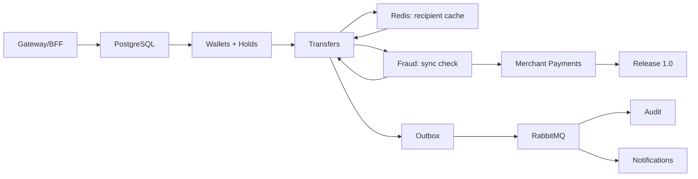

# Otus Payment System — Roadmap

> **Актуально на 30.10.2026.** Базовая точка нового плана — понедельник **2 ноября 2026**.
> Октябрь 2026 зафиксирован как **M0 (факт)**, а не растягивается на ноябрь.
>
> Связанные документы: [ADR 0001 — API Gateway](./adr/0001-api-gateway.md) · [Архитектура](./architecture.ru.md) · [Bounded contexts](./bounded-contexts.md) · [Требования к auth](./auth-requirements.ru.md)
>
> Дашборд доски: [#70](https://github.com/PoyarkinES/otus_payment_system/issues/70)

## 1. Зачем пересобирать план

Старый roadmap был ровным: месяц 1 — Identity + PostgreSQL, месяц 6 — платёжный шлюз. По факту получилось иначе:

- **Identity ушёл вперёд.** Регистрация, логин, JWT, роли, профиль, block/unblock и тесты сделаны к 21 октября — это лучше старого графика.
- **PostgreSQL и инфраструктура не сделаны.** PostgreSQL, миграции, Docker, логирование и тесты в CI отсутствуют; из-за этого Wallets и следующие этапы сдвигаются примерно на месяц.
- **Gateway вообще не был запланирован.** В roadmap был только Payment Gateway (мерчанты), но не edge/BFF между фронтендом и сервисами.
- **Задачи не были разбиты по месяцам и неделям.** На доске висели 10 задач из первого месяца без milestones, порядка и зависимостей.

Новый план не «догоняет» старый любой ценой. Он пересобран вокруг критического пути:

```
Gateway → PostgreSQL → Wallets → Transfers → Outbox/RabbitMQ → Audit/Notifications → Fraud → Merchant Payments → Release 1.0
```

## 2. Факт на 30.10.2026 (M0)

| Область | Статус | Комментарий |
|---|---|---|
| Каркас репозитория, split по контекстам | ✅ Готово | 7 решений, `src`/`test`, SharedKernel |
| Документация: архитектура, bounded contexts, auth | ✅ Готово | #15, #18, #23 |
| Identity MVP | ✅ Готово | #12: register/login/JWT, `/auth/me`, профиль, block/unblock, роли |
| Unit-тесты Identity | ✅ Есть | Domain/Application/Infrastructure/Host |
| CI | 🟡 Частично | Собирает решения, но **не запускает тесты** |
| PostgreSQL + миграции | ❌ Нет | Identity на EF InMemory, #10 |
| Refresh/logout, rate limiting | ❌ Нет | Требования в auth-requirements, реализации нет |
| API Gateway / BFF | ❌ Нет | В старом плане отсутствовал |
| Docker Compose | ❌ Нет | Нет ни PG, ни RabbitMQ, ни общего стека |
| Wallets/Transfers/Fraud/Notifications/Audit | ⚪ Каркас | Только доменные события, бизнес-логики нет |

**Вывод:** Identity готов и частично опережает старый план, но PostgreSQL и Gateway не сделаны. Поэтому Wallets и следующие этапы сдвигаются на месяц: октябрь закрывается как M0, а шесть месяцев core-разработки начинаются с ноября.

## 3. Принципы нового плана

1. **Сначала критический путь, потом украшения.** Никакого Kubernetes и Event Sourcing, пока не работают Gateway, PostgreSQL, кошелёк и перевод. Redis появляется только там, где он нужен по архитектуре — кэш валидации получателя в M3, — а не как «кэш всего».
2. **Вертикальные срезы.** Каждая неделя заканчивается чем-то запускаемым: endpoint, сценарий, миграция, тест.
3. **Один вход для клиента.** Фронтенд ходит только через Gateway/BFF; внутренние адреса сервисов — деталь реализации.
4. **Контракты раньше реализации.** Сначала API/событие/схема, потом код.
5. **Тесты не после, а вместе.** Integration-тесты на PostgreSQL и события — часть Definition of Done.
6. **Буфер в каждой четвёртой неделе.** W4/W8/W12/W16/W20/W24 — полировка и ретро, а не новая функциональность.
7. **WIP ≤ 2.** Не больше двух задач в работе одновременно.
8. **Месяц закрывается по exit criteria, а не по календарю.**

## 4. Обзор программы

| Месяц | Даты | Цель | Эпик | Итог |
|---|---|---|---|---|
| **M0** | 5–30 октября 2026 | Bootstrap, документация, Identity MVP | [#39](https://github.com/PoyarkinES/otus_payment_system/issues/39) | Identity готов; PostgreSQL и Gateway перенесены в M1 |
| **M1** | 2–29 ноября 2026 | Edge & Foundation: Gateway/BFF, PostgreSQL, Identity hardening | [#40](https://github.com/PoyarkinES/otus_payment_system/issues/40) | Фронтенд ходит в одну точку; Identity в PostgreSQL; refresh/logout; CI с тестами |
| **M2** | 30 ноября — 27 декабря 2026 | Wallets: кошельки, холды, балансовые операции | [#41](https://github.com/PoyarkinES/otus_payment_system/issues/41) | `available`/`held`, пополнение/списание, hold/confirm/release, история, optimistic locking |
| **M3** | 28 декабря 2026 — 24 января 2027 | Transfers: идемпотентность, Redis, hold, Fraud sync | [#42](https://github.com/PoyarkinES/otus_payment_system/issues/42) | Безопасный перевод wallet-to-wallet + `Confirming` + аудит + outbox |
| **M4** | 25 января — 21 февраля 2027 | Async: RabbitMQ, Audit, Notifications | [#43](https://github.com/PoyarkinES/otus_payment_system/issues/43) | События Payments/Wallets доходят до Audit и Notifications, at-least-once, retry/DLQ |
| **M5** | 22 февраля — 21 марта 2027 | Fraud: правила, fallback, алерты | [#44](https://github.com/PoyarkinES/otus_payment_system/issues/44) | Sync-блокировка до confirm + fallback при недоступности Fraud |
| **M6** | 22 марта — 18 апреля 2027 | Merchant Payments + Release 1.0 | [#45](https://github.com/PoyarkinES/otus_payment_system/issues/45) | API keys, платежи, webhooks, возвраты, релиз |
| **M7** | 19 апреля — 23 мая 2027 | **Post-1.0:** KYC/Onboarding — MongoDB, MinIO, gRPC | [#73](https://github.com/PoyarkinES/otus_payment_system/issues/73) | Синтетический документ → MinIO, метаданные → Mongo, статус по gRPC, порог в Payments |

**Итого:** 24 недели core-разработки (M1–M6) + 5 недель post-1.0 (M7). Полный frontend UI — отдельный post-1.0 трек, чтобы не сорвать backend-цели.

**Команда:** 3 человека. M7 можно вести параллельно с M6, если один человек освобождается раньше, но **KYC не должен блокировать релиз 1.0** и включается feature flag’ом.

## 5. M1. Edge & Foundation (2–29 ноября 2026)

**Цель:** фронтенд может ходить в один URL, Identity хранит данные в PostgreSQL, сессия и ошибки ведут себя предсказуемо.

**Почему Gateway здесь, а не в месяце 6:** Payment Gateway — это merchant acquiring (магазины, API keys, webhooks). API Gateway — это edge/BFF, без которого фронтенд вынужден знать все сервисы и дублировать auth/CORS. Это разные вещи; см. [ADR 0001](./adr/0001-api-gateway.md).

| Неделя | Даты | Фокус | Issue |
|---|---|---|---|
| W1 | 2–8 ноября | Каркас Gateway, маршруты, JWT, `X-User-Id`, CORS | [#46](https://github.com/PoyarkinES/otus_payment_system/issues/46) |
| W2 | 9–15 ноября | PostgreSQL для Identity, миграции, docker-compose, Testcontainers | [#47](https://github.com/PoyarkinES/otus_payment_system/issues/47), [#10](https://github.com/PoyarkinES/otus_payment_system/issues/10) |
| W3 | 16–22 ноября | Refresh/logout, RSA/JWKS для Gateway, rate limiting, ProblemDetails, Serilog | [#48](https://github.com/PoyarkinES/otus_payment_system/issues/48), [#20](https://github.com/PoyarkinES/otus_payment_system/issues/20), [#21](https://github.com/PoyarkinES/otus_payment_system/issues/21), [#22](https://github.com/PoyarkinES/otus_payment_system/issues/22) |
| W4 | 23–29 ноября | BFF `/bff/me`, `GET /users/{id}` для ACL, health, тесты в CI, Docker, ретро | [#49](https://github.com/PoyarkinES/otus_payment_system/issues/49), [#16](https://github.com/PoyarkinES/otus_payment_system/issues/16), [#19](https://github.com/PoyarkinES/otus_payment_system/issues/19) |

**Exit criteria месяца**

- [ ] `Gateway.Host` собирается, `/health` → 200.
- [ ] `POST /api/identity/auth/login` и `/api/identity/auth/me` работают через Gateway.
- [ ] JWT валидируется на edge; без токена — 401, с токеном — 200; Gateway добавляет `X-User-Id`.
- [ ] Identity работает на PostgreSQL; миграции применяются; данные переживают рестарт.
- [ ] Refresh/logout/rotation; rate limiting login; единый ProblemDetails.
- [ ] `GET /bff/me` отдаёт профиль и роли; `GET /users/{id}` доступен для ACL.
- [ ] CI запускает тесты, Docker Compose поднимает Gateway + Identity + PostgreSQL.

**Что осознанно не делаем:** полный UI, RabbitMQ, merchant payments. Redis появится в M3 под кэш валидации получателя.

## 6. M2. Wallets (30 ноября — 27 декабря 2026)

**Цель:** кошелёк с моделью `available`/`held`, холдами, пополнением/списанием и историей. Это соответствует [architecture.ru.md](./architecture.ru.md), разделы 4.1 и 6.

| Неделя | Даты | Фокус | Issue |
|---|---|---|---|
| W5 | 30 ноября — 6 декабря | Wallet aggregate (`available`, `held`), `WalletTransactions`, схема `Holds`, create/get, Wallets.Host | [#50](https://github.com/PoyarkinES/otus_payment_system/issues/50), [#17](https://github.com/PoyarkinES/otus_payment_system/issues/17), [#11](https://github.com/PoyarkinES/otus_payment_system/issues/11), [#9](https://github.com/PoyarkinES/otus_payment_system/issues/9) |
| W6 | 7–13 декабря | Пополнение/списание, ledger, optimistic locking, идемпотентность | [#51](https://github.com/PoyarkinES/otus_payment_system/issues/51), [#8](https://github.com/PoyarkinES/otus_payment_system/issues/8) |
| W7 | 14–20 декабря | Hold/confirm/release, автосоздание кошелька получателя, история, ownership, BFF | [#52](https://github.com/PoyarkinES/otus_payment_system/issues/52) |
| W8 | 21–27 декабря | Интеграционные тесты (включая конкурентные hold/confirm/release), демо, ретро | [#53](https://github.com/PoyarkinES/otus_payment_system/issues/53) |

**Exit criteria**

- [ ] Кошелёк создаётся и читается через Gateway; `available` и `held` разделены.
- [ ] Пополнение и списание работают; `available` не отрицательный.
- [ ] `hold`/`confirm`/`release` идемпотентны, холд хранится с `UNIQUE(transferId)`.
- [ ] `confirm` одной транзакцией списывает `held` и зачисляет получателю; при отсутствии кошелька получателя — создаёт его.
- [ ] История операций с пагинацией; чужой кошелёк недоступен.
- [ ] Интеграционные тесты на PostgreSQL зелёные.

## 7. M3. Transfers (28 декабря 2026 — 24 января 2027)

**Цель:** перевод по схеме из [architecture.ru.md](./architecture.ru.md): `Idempotency-Key` → валидация получателя (Redis/Identity) → `Created` → `hold` → Fraud → `confirm`/`release` → `Completed`/`Failed`/`Confirming`.

| Неделя | Даты | Фокус | Issue |
|---|---|---|---|
| W9 | 28 декабря — 3 января | Transfer aggregate (`Created`/`Held`/…), Idempotency-Key, Redis + `GET /users/{id}`, создание + hold | [#54](https://github.com/PoyarkinES/otus_payment_system/issues/54) |
| W10 | 4–10 января | Fraud sync, `confirm`/`release`, `Completed`/`Failed`, `Confirming`, базовый fallback | [#55](https://github.com/PoyarkinES/otus_payment_system/issues/55) |
| W11 | 11–17 января | Аудит, Repository/UoW, outbox `TransferCompleted`/`TransferFailed` | [#56](https://github.com/PoyarkinES/otus_payment_system/issues/56) |
| W12 | 18–24 января | Интеграционные тесты, E2E, ретро | [#57](https://github.com/PoyarkinES/otus_payment_system/issues/57) |

**Exit criteria**

- [ ] Порядок строгий: Idempotency-Key → валидация получателя → создание → hold.
- [ ] Redis-кэш `user:{id}` (TTL 60s/10s) и `GET /users/{id}` при cache miss.
- [ ] Fraud вызывается синхронно; `Approve` → confirm, `Block` → release.
- [ ] При неизвестном результате confirm перевод уходит в `Confirming`, а не `Failed`.
- [ ] Повторный запрос с тем же ключом возвращает сохранённый результат.
- [ ] `TransferCompleted`/`TransferFailed` пишутся в outbox атомарно с Transfer.
- [ ] E2E через Gateway: register → wallet → top-up → transfer → history.

**Известное ограничение MVP:** watchdog для зависших холдов и reconciliation для `Confirming` не реализуются; это ручная сверка (см. architecture.ru.md, раздел 9).

## 8. M4. Async, Audit, Notifications (25 января — 21 февраля 2027)

**Цель:** события Payments и Wallets доходят до Audit и Notifications через RabbitMQ и outbox; доставка at-least-once, потребители идемпотентны.

| Неделя | Даты | Фокус | Issue |
|---|---|---|---|
| W13 | 25–31 января | RabbitMQ, топология, outbox publisher (Payments + Wallets) | [#58](https://github.com/PoyarkinES/otus_payment_system/issues/58) |
| W14 | 1–7 февраля | Audit Service: consumer, append-only store, admin API | [#59](https://github.com/PoyarkinES/otus_payment_system/issues/59) |
| W15 | 8–14 февраля | Notifications: шаблоны, email-stub, retry/DLQ, email через Identity | [#60](https://github.com/PoyarkinES/otus_payment_system/issues/60) |
| W16 | 15–21 февраля | Resilience, observability, event-flow тесты, ретро | [#61](https://github.com/PoyarkinES/otus_payment_system/issues/61) |

**Exit criteria**

- [ ] RabbitMQ в Docker Compose; `TransferCreated`/`TransferCompleted`/`TransferFailed` публикуются из outbox.
- [ ] `WalletCredited`/`WalletDebited` публикуются из outbox Wallets.
- [ ] Audit пишет неизменяемый журнал (`eventId` UNIQUE) и отдаёт admin API.
- [ ] Notifications отправляет transfer/wallet-уведомления через email-stub; email получателя берётся из Identity.
- [ ] At-least-once: повторная доставка не создаёт дубль; retry/DLQ работают.

**Вне MVP:** события `UserRegistered` от Identity и async follow-up Fraud — отложены (architecture.ru.md, раздел 8.2).

## 9. M5. Fraud (22 февраля — 21 марта 2027)

**Цель:** Fraud синхронно решает `Approve`/`Block` до `confirm`; при недоступности Fraud работает fallback по порогу, а не «падаем всем переводом».

| Неделя | Даты | Фокус | Issue |
|---|---|---|---|
| W17 | 22–28 февраля | Правила, `POST /fraud/check`, `GET /fraud/settings`, sync-вызов из Payments | [#62](https://github.com/PoyarkinES/otus_payment_system/issues/62) |
| W18 | 1–7 марта | Velocity, решения/алерты, admin API | [#63](https://github.com/PoyarkinES/otus_payment_system/issues/63) |
| W19 | 8–14 марта | Blacklist, риск-скоринг, пороги, fallback | [#64](https://github.com/PoyarkinES/otus_payment_system/issues/64) |
| W20 | 15–21 марта | Тесты правил, false positive, latency, ретро | [#65](https://github.com/PoyarkinES/otus_payment_system/issues/65) |

**Exit criteria**

- [ ] `POST /fraud/check` возвращает `Approve`/`Block`; Payments вызывает его между hold и confirm.
- [ ] При timeout/недоступности Fraud: `amount < fallbackThreshold` → Approve, иначе Block.
- [ ] Порог fallback берётся из `GET /fraud/settings` и кэшируется; есть Polly timeout 2s + circuit breaker.
- [ ] Blacklist и risk score влияют на решение; решения сохраняются в БД.
- [ ] p95 check в бюджете; ложные срабатывания измеряются.

**Вне MVP:** async follow-up, Review-флоу и публикация событий Fraud — отложены (architecture.ru.md, раздел 8.2).

## 10. M6. Merchant Payments + Release 1.0 (22 марта — 18 апреля 2027)

**Цель:** платёжный шлюз для мерчантов и релиз, который можно показывать.

> Это расширение сверх MVP-архитектуры: в [architecture.ru.md](./architecture.ru.md), раздел 8.2, merchants отложены. M6 добавляет их как следующий слой после стабильных переводов, Fraud и событий.

| Неделя | Даты | Фокус | Issue |
|---|---|---|---|
| W21 | 22–28 марта | Merchant, API keys, `POST /api/payments` | [#66](https://github.com/PoyarkinES/otus_payment_system/issues/66) |
| W22 | 29 марта — 4 апреля | Payment lifecycle, webhooks, retry/подпись | [#67](https://github.com/PoyarkinES/otus_payment_system/issues/67) |
| W23 | 5–11 апреля | Возвраты, платёжные ссылки, merchant docs | [#68](https://github.com/PoyarkinES/otus_payment_system/issues/68) |
| W24 | 12–18 апреля | Observability, нагрузка, security review, релиз | [#69](https://github.com/PoyarkinES/otus_payment_system/issues/69) |

**Exit criteria**

- [ ] Мерчант создаёт платёж по API key.
- [ ] Webhook с подписью и retry; статусы платежа терминальны.
- [ ] Возврат и платёжная ссылка работают.
- [ ] Метрики/трейсы/дашборды; нагрузочный тест; security checklist.
- [ ] Тег `v1.0` и release notes.

## 11. M7. KYC/Onboarding — post-1.0 (19 апреля — 23 мая 2027)

**Цель:** добавить подтверждение личности как отдельный supporting-контекст, не ломая релиз 1.0.

**Почему после 1.0:** KYC не нужен для базового перевода, но нужен для высоких лимитов, мерчантского онбординга и «взрослого» финтех-сценария. Это также полигон для MongoDB, MinIO и gRPC — без риска для денежного контура.

**Что делаем:**

- новый bounded context `Kyc/`;
- метаданные KYC-кейса — в MongoDB;
- сканы/файлы — в MinIO (S3-совместимое хранилище), не в Mongo и не в PostgreSQL;
- gRPC `GetKycStatus`/`WatchKycStatus` для внутренних вызовов;
- REST upload/status через Gateway для фронтенда;
- Payments проверяет KYC-статус выше порога через feature flag;
- аудит, шифрование, retention, запрет PII в логах;
- **только синтетические документы** в dev/demo.

**Почему это обоснованно:**

| Технология | Проблема | Решение |
|---|---|---|
| MongoDB | Разные типы документов и ответы провайдера, гибкая схема | Документная модель `KycCase` |
| MinIO/S3 | Сканы — бинарные объекты, их нельзя хранить в БД | Private bucket, signed URL, lifecycle |
| gRPC | Внутренним сервисам нужен typed-контракт и низкая задержка | `.proto`, `GetKycStatus`, deadlines |

**Команда 3 человека:**

| Роль | Ответственность |
|---|---|
| A | KYC domain, Mongo, workflow статусов, verification stub |
| B | MinIO/S3, upload pipeline, файлы, шифрование, security |
| C | gRPC-контракт, Gateway/Identity/Payments интеграция, observability |
| Все | Контракты и threat model в W25, ревью PR друг друга |

**Почему успеваем:** 5 недель на отдельный трек, 3 человека, контракты фиксируются в W25, UI не делаем. Если не успеваем — режем `WatchKycStatus`/streaming и admin UI, но не безопасность.

| Неделя | Даты | Фокус | Issue |
|---|---|---|---|
| W25 | 19–25 апреля | ADR 0002/0003, контракты, Mongo, MinIO, домен | [#74](https://github.com/PoyarkinES/otus_payment_system/issues/74) |
| W26 | 26 апреля — 2 мая | Загрузка документов, MinIO, верификация | [#75](https://github.com/PoyarkinES/otus_payment_system/issues/75) |
| W27 | 3–9 мая | gRPC-контракт, Payments/Identity интеграция | [#76](https://github.com/PoyarkinES/otus_payment_system/issues/76) |
| W28 | 10–16 мая | Безопасность, тесты, аудит | [#77](https://github.com/PoyarkinES/otus_payment_system/issues/77) |
| W29 | 17–23 мая | Буфер, демо, документация | [#78](https://github.com/PoyarkinES/otus_payment_system/issues/78) |

**Exit criteria**

- [ ] Синтетический документ загружается через Gateway; файл в MinIO, метаданные в Mongo.
- [ ] `KycCase`: `Draft` → `Pending` → `Approved`/`Rejected`/`RequiresAction`.
- [ ] `GetKycStatus` по gRPC работает; Payments применяет порог через feature flag.
- [ ] PII не в логах; доступ к файлам только через KYC; аудит есть.
- [ ] Integration/contract tests зелёные; demo и docs готовы.
- [ ] С выключенным feature flag поведение 1.0 не меняется.

**Вне scope M7:** реальные паспорта/ПДн, реальный провайдер, OCR/liveness, юридические заявления о 152-ФЗ/GDPR/PCI DSS, полный admin UI.

## 12. Зависимости и критический путь



Правила:

- Не начинать Wallets, пока Gateway и PostgreSQL не закрыты: иначе снова появятся прямые вызовы и InMemory.
- Не начинать Transfers, пока Wallets и холды не закрыты: перевод — это `hold` → Fraud → `confirm`/`release`.
- Не начинать Fraud, пока Transfers не закрыт: нечего проверять.
- Redis добавляется в M3 только под кэш валидации получателя, не раньше.
- Не начинать Merchant Payments, пока Transfers и Fraud не закрыты.
- M4 (RabbitMQ/Audit) можно вести параллельно с началом M5 только после стабильного outbox.

## 13. Definition of Done

**Для недели**

- [ ] Все задачи недели закрыты или явно перенесены с причиной.
- [ ] Код собирается, тесты зелёные, CI зелёный.
- [ ] Есть демонстрируемый результат (endpoint/сценарий/миграция).
- [ ] Обновлены docs/OpenAPI, если изменился контракт.
- [ ] Dashboard #70 обновлён в пятницу.

**Для месяца**

- [ ] Exit criteria эпика закрыты.
- [ ] Нет известных блокеров для следующего месяца.
- [ ] Integration-тесты критического пути зелёные.
- [ ] Проведено ретро: что сработало, что переносим.

## 14. Риски и буферы

| Риск | Вероятность | Влияние | Мера |
|---|---|---|---|
| Gateway + PostgreSQL не влезут в M1 | Средняя | Высокое | W4 — буфер; BFF можно урезать до `/bff/me` |
| Wallets займут больше 4 недель | Средняя | Высокое | W8 — буфер; историю можно перенести в начало M3 |
| Hold/confirm/release сложнее, чем debit/credit | Высокая | Высокое | Сначала один happy-path hold → confirm, потом release/Confirming; тесты на идемпотентность |
| Redis станет лишней зависимостью | Средняя | Среднее | Только `user:{id}` cache; при падении Redis — fallback на Identity |
| RabbitMQ/outbox окажутся сложнее | Средняя | Среднее | Начать с одного события `TransferCreated`, остальные — после |
| Fraud даст много ложных срабатываний | Высокая | Среднее | Порог Block/Approve + fallback, метрики false positive |
| Merchant Payments не влезут в M6 | Средняя | Высокое | W23 — буфер; payment links можно вынести в post-1.0 |
| KYC/Mongo/MinIO не влезут в M7 | Средняя | Среднее | W29 — буфер; режем `WatchKycStatus` и admin UI, не безопасность |
| PII попадёт в логи/репозиторий | Низкая | Критическое | Только синтетические документы, маскирование, запрет PII в логах, security checklist W28 |
| Три человека мешают друг другу | Средняя | Среднее | Контракты в W25, чёткое владение треками, ревью PR, feature flag |
| Команда подключается позже | Высокая | Среднее | Сначала core-план, KYC — post-1.0; новички начинают с тестов/доков, не с денежного контура |

## 15. Что вне core-плана

- Полный frontend UI (React/Blazor) — **post-1.0**, после стабильного BFF.
- KYC/Onboarding — **M7 post-1.0**, не блокирует 1.0 и включается feature flag’ом.
- Kubernetes, service mesh, Event Sourcing — не раньше 1.0.
- Redis как общий кэш/лимиты — нет; Redis только под `user:{id}` в M3.
- MongoDB — только KYC-метаданные в M7, не общий store.
- MinIO/S3 — только KYC-файлы в M7, не файлохранилище для всего.
- Watchdog зависших холдов и reconciliation `Confirming` — ручная сверка в MVP.
- MFA, внешние IdP, PCI DSS, реальные платежные провайдеры.
- Мобильное приложение.

## 16. Правила доски

- **Milestones** = M0–M7 (M7 — post-1.0).
- **Issues** = недели `[M1W1] Неделя: …`…`[M7W29] Неделя: …` + детальные задачи (старые #8–#22).
- **Labels**: `area/*` (включая `area/kyc`), `type/*`, `priority/P0–P2`, `week/01–29`, `status/*`, `post-1.0`.
- **WIP ≤ 2**, в пятницу — статус и перенос хвостов.
- **Один issue = один вертикальный срез**, а не «сделать всё».
- Если задача не влезает в неделю — режем scope, а не двигаем критический путь.

### Если нужна kanban-доска GitHub Project

Issues и milestones уже дают план; для визуальной kanban-доски нужен GitHub Project (Projects v2). Ему требуется scope `project`:

```bash
gh auth refresh -s project
gh project create --owner PoyarkinES --title "Otus Payment System — Roadmap"
```

Рекомендуемые поля и представления:

| Поле | Тип | Значения |
|---|---|---|
| Month | Single select | M0, M1, M2, M3, M4, M5, M6, M7 (post-1.0) |
| Week | Number | 1–29 |
| Status | Single select | Todo, In Progress, Blocked, Done |
| Area | Single select | Identity, Wallets, Payments, Fraud, Notifications, Audit, Gateway, KYC, Platform |
| Priority | Single select | P0, P1, P2 |

Представления:

1. **Board** — group by `Status`, filter `is:issue`, sort by `Week`.
2. **Table** — group by `Month`, columns: Title, Week, Status, Area.
3. **Roadmap** — по `Week`/`Month` для планирования.
4. **My week** — filter `week/XX` + `assignee:@me`.

Пока Project не создан, фильтры по milestone и labels работают прямо в Issues: `milestone:"M1 · Ноябрь 2026 — Edge & Foundation"`, `label:week/01`, `label:status/behind`.

## 17. Что делать на этой неделе (до 2 ноября)

1. Gateway (#46) закрыт; следующий шаг — M1W2: PostgreSQL для Identity (#47/#10).
2. Поднять Docker Compose: PostgreSQL + Testcontainers.
3. M7 KYC не начинать до стабильного 1.0; ADR/контракты можно готовить параллельно.
4. Для KYC прочитать [ADR 0002](./adr/0002-kyc-storage.md) и [ADR 0003](./adr/0003-kyc-grpc.md).

## 18. Ссылки

- Дашборд: [#70](https://github.com/PoyarkinES/otus_payment_system/issues/70)
- Эпики: [#39](https://github.com/PoyarkinES/otus_payment_system/issues/39) M0 · [#40](https://github.com/PoyarkinES/otus_payment_system/issues/40) M1 · [#41](https://github.com/PoyarkinES/otus_payment_system/issues/41) M2 · [#42](https://github.com/PoyarkinES/otus_payment_system/issues/42) M3 · [#43](https://github.com/PoyarkinES/otus_payment_system/issues/43) M4 · [#44](https://github.com/PoyarkinES/otus_payment_system/issues/44) M5 · [#45](https://github.com/PoyarkinES/otus_payment_system/issues/45) M6 · [#73](https://github.com/PoyarkinES/otus_payment_system/issues/73) M7
- [ADR 0001 — API Gateway](./adr/0001-api-gateway.md)
- [ADR 0002 — KYC storage](./adr/0002-kyc-storage.md)
- [ADR 0003 — KYC gRPC](./adr/0003-kyc-grpc.md)
- [Архитектура](./architecture.ru.md)
- [Bounded contexts](./bounded-contexts.md)
- [Требования к auth](./auth-requirements.ru.md)
