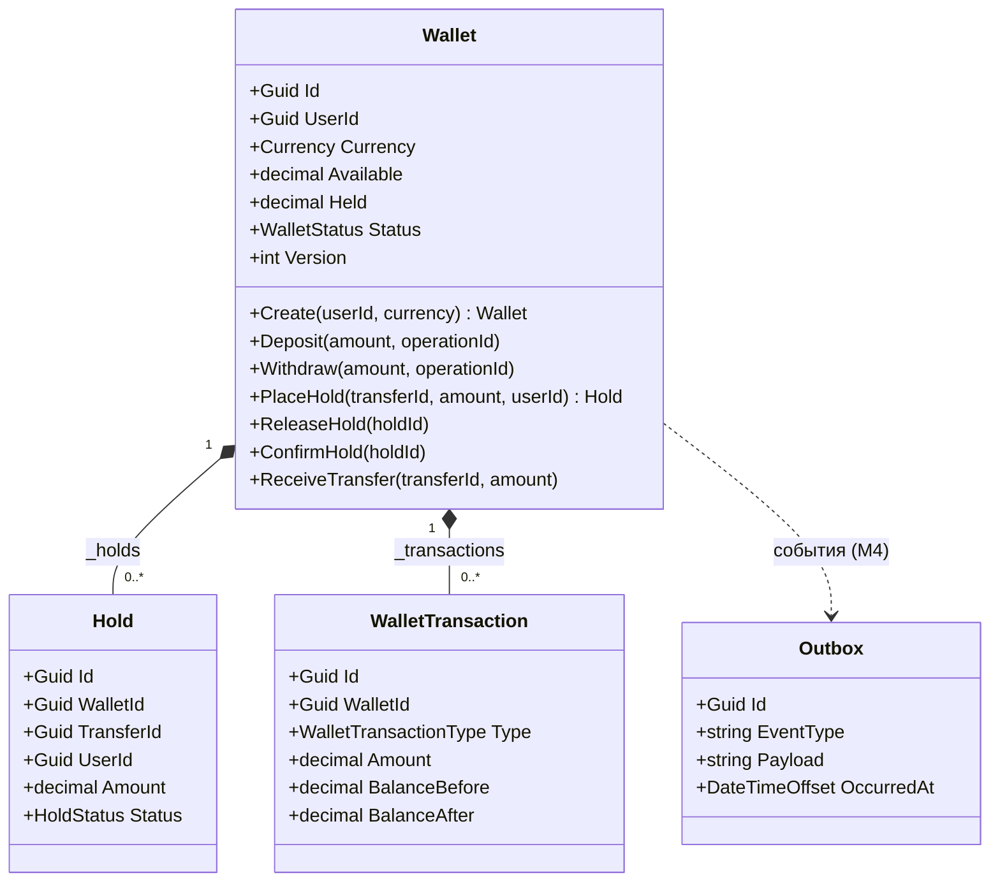
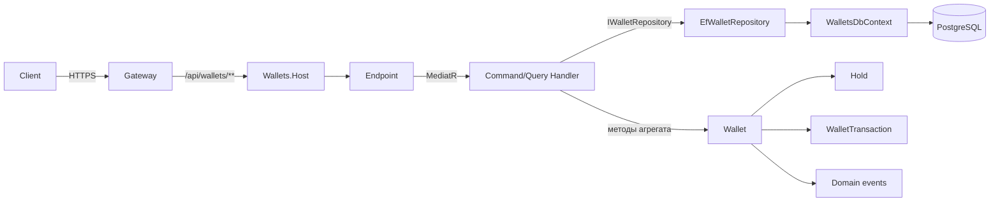
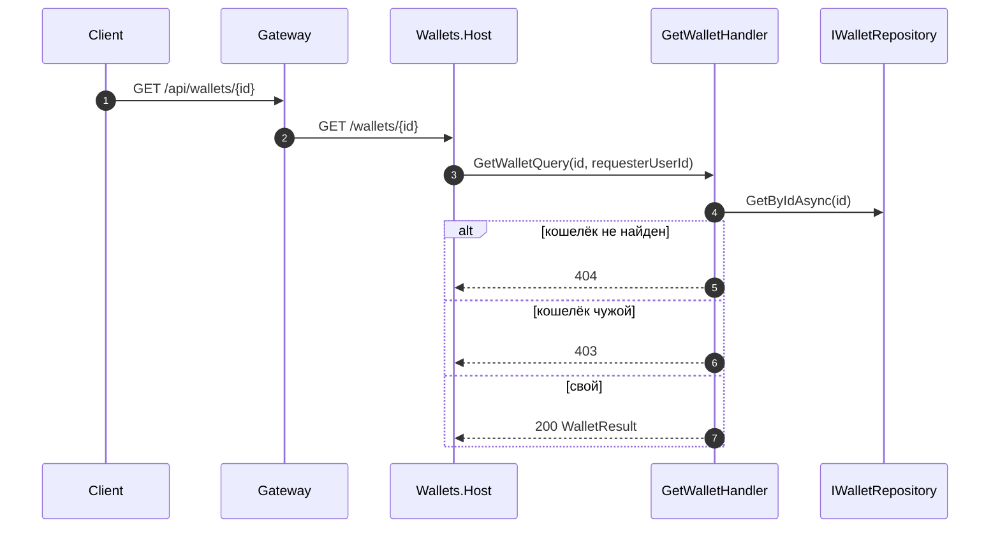

# Wallets: взаимодействие сущностей, инициализация и вызовы

> **Статус:** M2W5 (#50), реализация в ветке `feature/m2w5-wallets`. Domain, Application, Infrastructure, Host, Gateway-маршрут, 5 Host HTTP-тестов и 5 Gateway E2E готовы; остались зелёный прогон CI и техдолг.
>
> **Связанные документы:** [architecture.ru.md](./architecture.ru.md) · [db-schema.ru.md](./db-schema.ru.md) · [bounded-contexts.md](./bounded-contexts.md)

## 1. Зачем этот документ

В коде видно, **что** делает каждая сущность, но не видно **кто и когда её создаёт**, **кто имеет право вызывать её методы** и **как запрос доходит от Gateway до агрегата**. Без этого:

- легко создать `Wallet` или `Hold` в обход инвариантов (например, напрямую через `new`);
- непонятно, где заканчивается ответственность агрегата и начинается ответственность handler'а;
- EF-конфигурация и DI начинают диктовать доменную модель, а не наоборот;
- при добавлении hold/confirm/release появляются **теневые** обходы агрегата.

Документ фиксирует правила: **кто инициализирует**, **кто вызывает**, **что при этом меняется** и **где это должно жить**.

## 2. Границы агрегата

`Wallet` — агрегатный корень. `Hold` и `WalletTransaction` — сущности внутри агрегата: их нельзя создать или изменить в обход `Wallet`. `Outbox` — отдельная сущность/таблица, к агрегату не относится.



Правила границы:

1. `Wallet` — единственная точка входа для изменения баланса, холдов и ledger.
2. `Hold` и `WalletTransaction` создаются только методами `Wallet`. Их конструкторы `internal`/`private`.
3. `Hold` не хранит валюту: она всегда равна валюте кошелька.
4. `WalletTransaction` не редактируется и не удаляется: это append-only ledger.
5. `Outbox` не создаётся доменом напрямую: в M4 его будет писать application/infrastructure-слой в той же транзакции, что и `SaveChanges`.

## 3. Кто инициализирует сущности

| Объект | Публичная точка входа | Кто вызывает | Кто ещё может создать | Запрещено |
|---|---|---|---|---|
| `Wallet` | `Wallet.Create(userId, currency)` | `CreateWalletCommandHandler` (целевой) | EF Core — через `private Wallet()` при материализации | `new Wallet(...)` вне `Domain` |
| `Hold` | `Wallet.PlaceHold(transferId, amount, userId)` | `PlaceHoldCommandHandler` / Payments ACL (целевые) | EF Core — через `private Hold()` | `new Hold(...)` вне `Domain`; создание `Hold` в handler'е |
| `WalletTransaction` | `Wallet.AddTransaction(...)` (private) | Только методы `Wallet`: `Deposit`, `Withdraw`, `ConfirmHold`, `ReceiveTransfer` | EF Core — через `private WalletTransaction()` | Создание в handler'е/репозитории; редактирование записей |
| `Outbox` | фабрика/писатель outbox (M4) | Application/Infrastructure (M4) | EF Core — при чтении | Создание из домена напрямую |
| `Currency` | `Currency.Create(value)`, `Currency.Rub` | Handler/`Wallet.Create` | — | `new Currency(...)` (конструктор private) |
| `Money` | `Money.Create(amount, currency)`, `Money.Zero(currency)` | Handler/`Wallet` | — | `new Money(...)` (конструктор private) |
| `WalletsDbContext` | DI: `AddDbContext<WalletsDbContext>` | Host/DI | Тесты — через `new` с `DbContextOptions` | Создание в handler'е вручную |
| `CreateWalletCommandHandler` | MediatR `Send` | Endpoint `POST /api/wallets` | DI/MediatR | Вызов из другого handler'а напрямую |
| `GetWalletQueryHandler` | MediatR `Send` | Endpoint `GET /api/wallets/{id}` | DI/MediatR | Вызов из endpoint'а в обход MediatR |

Ключевое правило: **фабрика — единственный легальный способ создать агрегат; EF — единственное исключение, и оно не выполняет бизнес-инварианты.** Поэтому все инварианты должны проверяться в фабрике и методах, а не в конструкторе для EF.

## 4. Кто кого вызывает

### 4.1. Целевая цепочка запроса



### 4.2. Матрица вызовов

| Вызывающий | Вызываемый | Когда | Побочные эффекты |
|---|---|---|---|
| Endpoint | MediatR `Send` | На каждый HTTP-запрос | Нет; только маршрутизация в handler |
| Handler | `IWalletRepository.GetByIdAsync` / `GetByUserAndCurrencyAsync` | Перед операцией | Чтение агрегата с `Holds` и `Transactions` |
| Handler | `Wallet.Create` | `POST /api/wallets` | `WalletCreated`; `Version = 0`; `Available = Held = 0` |
| Handler | `Wallet.Deposit` | Пополнение | `Available += amount`; `WalletTransaction(TopUp)`; `BalanceDeposited` |
| Handler | `Wallet.Withdraw` | Списание | Проверка `Available`; `WalletTransaction(Withdrawal)`; `BalanceWithdrawn` |
| Handler | `Wallet.PlaceHold` | Hold от Payments | `Available -= amount`; `Held += amount`; `Hold(Active)`; ledger **не пишется** |
| Handler | `Wallet.ReleaseHold` | Отмена перевода | `Held -= amount`; `Available += amount`; `Hold(Released)`; ledger **не пишется** |
| Handler | `Wallet.ConfirmHold` | Успешный перевод | `Held -= amount`; `Hold(Completed)`; `WalletTransaction(TransferOut)`; `BalanceTransferredOut` |
| Handler | `Wallet.ReceiveTransfer` | Зачисление получателю | `Available += amount`; `WalletTransaction(TransferIn)`; `BalanceTransferredIn` |
| Handler | `IWalletRepository.SaveChangesAsync` | После команды | `UPDATE/INSERT`; проверка `Version` |
| EF Core | `private Wallet()`, `private Hold()`, `private WalletTransaction()` | Материализация из БД | Инварианты **не** выполняются; поля заполняются из колонок |
| Outbox dispatcher (M4) | `Wallet.ClearDomainEvents` | После записи outbox | Очистка `DomainEvents` |
| Payments | `POST /api/wallets/holds` и т.д. | M3 | Создаёт/подтверждает/снимает hold через API Wallets |

### 4.3. Что handler НЕ делает

- Не создаёт `Hold`/`WalletTransaction` вручную.
- Не меняет `Available`/`Held` напрямую.
- Не пишет в `WalletsDbContext` в обход репозитория (кроме тестов).
- Не вызывает `SaveChanges` до завершения доменной операции.
- Не доверяет `userId` из тела запроса: берёт `sub` из JWT.

## 5. Сценарии

### 5.1. Создание кошелька

```mermaid
sequenceDiagram
    autonumber
    participant C as Client
    participant G as Gateway
    participant H as Wallets.Host
    participant M as MediatR
    participant Hd as CreateWalletHandler
    participant R as IWalletRepository
    participant D as WalletsDbContext
    participant P as PostgreSQL

    C->>G: POST /api/wallets { currency }
    G->>G: Проверка JWT, sub, role
    G->>H: POST /wallets (Authorization: Bearer)
    H->>H: Валидация JWT; userId = sub
    H->>M: CreateWalletCommand(userId, currency)
    M->>Hd: Handle
    Hd->>R: ExistsAsync(userId, currency)
    R->>D: AnyAsync
    D->>P: SELECT
    Hd->>Hd: Wallet.Create(userId, currency)
    Hd->>R: AddAsync(wallet)
    R->>D: Add
    Hd->>R: SaveChangesAsync
    D->>P: INSERT
    Hd-->>H: WalletResult
    H-->>G: 201 Created
    G-->>C: 201
```

Ошибки: `400` — неверная валюта; `409` — кошелёк с такой валютой уже есть; `401` — нет токена. Гонка двух `POST`: уникальный индекс `IX_Wallets_UserId_Currency` — последний барьер, `DbUpdateException` → `409`.

> `WalletResult` лежит в `Wallets.Application/Contracts/WalletResult.cs`; `Host/Contracts` — только request-DTO. Это же правило действует для остальных сервисов.

### 5.2. Чтение кошелька с ownership



Политика: `404` — кошелька нет; `403` — кошелёк существует, но принадлежит другому пользователю (см. [auth-requirements.ru.md](./auth-requirements.ru.md), [api-errors.ru.md](./api-errors.ru.md)).

### 5.3. Hold → confirm / release

```mermaid
sequenceDiagram
    autonumber
    participant P as Payments
    participant H as Wallets.Host
    participant Hd as HoldHandler
    participant W as Wallet
    participant R as IWalletRepository

    P->>H: POST /api/wallets/holds { walletId, transferId, amount }
    H->>Hd: PlaceHoldCommand
    Hd->>R: GetByIdAsync(walletId)
    R-->>Hd: Wallet (с Holds)
    Hd->>W: PlaceHold(transferId, amount, userId)
    alt hold уже есть
        W-->>Hd: существующий Hold
    else недостаточно Available
        W-->>Hd: DomainException(Conflict)
    else успех
        W-->>Hd: новый Hold(Active)
    end
    Hd->>R: SaveChangesAsync
    Hd-->>P: 200 { holdId }

    P->>H: POST /api/wallets/holds/{holdId}/confirm
    H->>Hd: ConfirmHoldCommand
    Hd->>R: GetByIdAsync(walletId)
    Hd->>W: ConfirmHold(holdId)
    W->>W: Held -= amount; Hold.Complete(); ledger TransferOut
    Hd->>R: SaveChangesAsync
    Hd-->>P: 204
```

`ReleaseHold` — зеркальная операция: `Held → Available`, `Hold.Released`, ledger не пишется.

## 6. EF Core: материализация и конфигурация

### 6.1. Что маппится

| Сущность | Таблица | Ключевые настройки |
|---|---|---|
| `Wallet` | `Wallets` | `Currency` → `varchar(3)`; `Available/Held` → `numeric(18,4)`; `Status` → `int`; `Version` — concurrency token; `UNIQUE(UserId, Currency)` |
| `Hold` | `Holds` | `TransferId` — `UNIQUE`; `Status` → `int`; FK `WalletId` |
| `WalletTransaction` | `WalletTransactions` | `Type` → `int`; `Currency` → `varchar(3)`; индекс `(WalletId, CreatedAt)` |
| `Outbox` | `Outbox` | `Payload` → `jsonb`; `PublishedAt` nullable |

### 6.2. Кто и как материализует агрегат

EF Core — единственный, кто создаёт сущности в обход фабрик:

1. `WalletsDbContext.Wallets` → `private Wallet()` → заполнение полей из колонок.
2. `WalletsDbContext.Holds` / `WalletTransactions` → `private Hold()` / `private WalletTransaction()`.
3. Навигации `Wallet.Holds` и `Wallet.Transactions` должны заполняться через backing fields `_holds` и `_transactions`.
4. `Version` читается как `OriginalValue` и участвует в `WHERE Version = @old`.
5. Для `PlaceHold`/`ConfirmHold`/`ReleaseHold` репозиторий обязан загрузить `Holds` (`Include`), иначе агрегат не увидит существующий холд, а `UNIQUE(TransferId)` сработает только на `INSERT`.

### 6.3. Требования к конфигурации

- `Wallet.Holds` и `Wallet.Transactions` — read-only коллекции; для них **обязательно** задать field access: `builder.Navigation(w => w.Holds).UsePropertyAccessMode(PropertyAccessMode.Field);` и то же для `Transactions`. Без этого EF может попытаться использовать get-only свойство; компиляция модель не проверяет, поэтому нужен runtime-тест с `Include(w => w.Holds)`.
- `Hold` и `WalletTransaction` не имеют навигации на `Wallet` — это нормально для `WithOne()`, но FK должен быть явно задан.
- `Wallet.Total`, `DomainEvents` — `Ignore` (вычисляемые/не хранятся).
- `Hold.Status` инициализируется `HoldStatus.Active` (исправить `Status = 0` в `Hold` — одна строка, M2W5, не техдолг).
- `Version` увеличивается в `Wallet.Touch`; при `DbUpdateConcurrencyException` handler должен вернуть `409` или повторить операцию.

## 7. DI, Host и Gateway

### 7.1. Регистрация в DI

```csharp
services.AddDbContext<WalletsDbContext>(options =>
    options.UseNpgsql(configuration.GetConnectionString("WalletsDb")));

services.AddScoped<IWalletRepository, EfWalletRepository>();
services.AddMediatR(cfg => cfg.RegisterServicesFromAssemblyContaining<CreateWalletCommand>());
```

> Имя ключа — `WalletsDb` (по аналогии с `IdentityDb`); в `docker-compose.yml` сервис Wallets пока не добавлен, поэтому ключ ещё не заведён.
>
> `IUnitOfWork` не вводим, пока репозиторий один: `IWalletRepository.SaveChangesAsync` и scoped `DbContext` закрывают транзакцию сценария. Отдельный unit of work появится, если в одной транзакции будут несколько репозиториев.

| Сервис | Lifetime | Почему |
|---|---|---|
| `WalletsDbContext` | Scoped | Один экземпляр на HTTP-запрос; не потокобезопасен |
| `IWalletRepository` | Scoped | Работает с `DbContext` запроса |
| MediatR handlers | Transient | Создаются на запрос |
| `TimeProvider` (если появится) | Singleton | Тесты не зависят от часов машины |

### 7.2. Host

- `Program.cs`: Serilog, `AddApiProblems`, Swagger, JWT Bearer, `AddWalletsInfrastructure`, MediatR, health; Host не доверяет `X-User-Id`.
- JWT: `JwtBearer` + `JwksKeyStore` (TTL 10 минут, refresh по неизвестному `kid`), `Issuer/Audience/JwksUri`; без OIDC-discovery, потому что Identity публикует только JWKS. Подробно — [ADR 0005](./adr/0005-jwt-validation-in-services.md).
- Порядок middleware — как в Identity: correlation → логи → 500 → пустые 4xx/5xx → Swagger → `DomainExceptionMiddleware` → auth → endpoints.
- `DomainExceptionMiddleware` маппит `DomainError`: `Validation → 400`, `Unauthorized → 401`, `Forbidden → 403`, `NotFound → 404`, `Conflict → 409`.
- Эндпоинты — extension `MapWalletsEndpoints()` (как `MapAuthEndpoints()` в Identity), группа `/wallets`:
  - `POST /wallets` — `RequireAuthorization()`; `userId` из `sub`; `201` + `Location`.
  - `GET /wallets/{id:guid}` — `RequireAuthorization()`; ownership в handler'е; `200/403/404`.
  - `GET /health` — в `Program.cs`, анонимный.
- `Database:AutoMigrate` — только для compose; в обычном запуске миграции применяются вручную.
- Миграции: `IDesignTimeDbContextFactory<WalletsDbContext>` в `Infrastructure/Persistence/WalletsDbContextFactory.cs` (пока Host без `Program.cs`), строка — из `WALLETS_CONNECTION_STRING`/env; команда `dotnet ef migrations add InitialWallets --project ...Infrastructure --startup-project ...Infrastructure --output-dir Persistence/Migrations`.

### 7.3. Gateway

- Маршрут `/api/wallets/{**catch-all}` → кластер `wallets`, transform → `/wallets/{**catch-all}`.
- JWT валидируется на Gateway (edge) и **повторно в Wallets.Host**: issuer/audience/signature/lifetime, ключ — JWKS Identity.
- `userId` берётся из claim `sub`; `X-User-Id` добавляется Gateway только для внутренних вызовов и в публичных endpoint'ах Wallets не используется.
- Публичные запросы идут с `Authorization: Bearer`; сервисная аутентификация Payments → Wallets в MVP не реализована.
- Порт Wallets Host задаётся в `launchSettings.json`/`appsettings` (в контейнере — 8080); адрес — в `ReverseProxy:Clusters:wallets`.

## 8. Статусы и переходы

### 8.1. WalletStatus

| Из | В | Метод | Условие |
|---|---|---|---|
| Active | Frozen | `Freeze` (не реализован) | — |
| Frozen | Active | `Unfreeze` (не реализован) | — |
| Active/Frozen | Closed | `Close` (не реализован) | нет активных холдов |
| любое | — | `Deposit/Withdraw/PlaceHold/...` | только `Active` (проверка `EnsureActive`) |

### 8.2. HoldStatus

| Из | В | Метод | Условие |
|---|---|---|---|
| Active | Completed | `ConfirmHold` | hold найден и активен |
| Active | Released | `ReleaseHold` | hold найден и активен |
| Active | Expired | watchdog (не реализован) | истёк срок |
| Completed/Released/Expired | — | — | терминальные состояния |

## 9. Ownership и ответственность

- **Identity** владеет `UserId`; Wallets хранит `UserId` как ссылку без FK между сервисами.
- **Wallets** владеет балансом, холдами и ledger. Никто другой не меняет `Available`/`Held` напрямую.
- **Payments** владеет жизненным циклом перевода и вызывает Wallets: `hold → confirm/release`.
- **Пользователь** видит только свои кошельки: `Wallet.UserId == sub`.
- Один пользователь — один кошелёк на валюту: `UNIQUE(UserId, Currency)`.
- `Hold.UserId` — плательщик; нужен для аудита и проверки ownership на уровне API.

## 10. Текущее состояние и пробелы

| Слой | Состояние |
|---|---|
| Domain | `Wallet`, `Hold`, `WalletTransaction`, `Money`, `Currency`, события, ошибки — готовы |
| Infrastructure | `WalletsDbContext` + 4 конфигурации + `AddWalletsInfrastructure` + `EfWalletRepository` + миграция `InitialWallets` |
| Application | `CreateWallet`/`GetWallet` handlers, `IWalletRepository`, `WalletResult` |
| Host | `Program.cs`, `WalletsEndpoints`, middleware, JWT; API-тесты в `Host.IntegrationTests` |
| Gateway | маршрут `/api/wallets/**` → `http://localhost:5200/` добавлен |
| Tests | `Domain.Tests` 13 + `Host.Tests` 9 + `Infrastructure.Tests` 4 + `Host.IntegrationTests` 5 + `Gateway.Host.IntegrationTests` 5 = **36** |

Открытые вопросы после миграции:

1. CI workflow добавлен, но `on: push/pull_request: branches: [main]` — на feature-ветке прогона нет; зелёный CI пока не подтверждён.
2. Локальная конфигурация: `appsettings.Development` — compose-стиль (`postgres:5432`, `identity:8080`); Wallets в compose нет, локально нужны env-переопределения.
3. `CHECK (Available >= 0)`/`Held >= 0` в БД — нет, только доменные проверки.
4. `TimeProvider`: сейчас `DateTimeOffset.UtcNow`, тесты зависят от часов.
5. `Outbox`: фабрика/писатель и сериализация `Payload` появятся в M4.
6. `Freeze/Unfreeze/Close` не реализованы.
7. `DbUpdateConcurrencyException` (409/retry) не обработан; `DbUpdateException` по unique-индексу маппится в `DomainException(Conflict)`.
8. `JwtOptions` в Host не используется: `AddJwtBearerFromJwks` читает `IConfiguration` напрямую.
9. `CreateWalletRequest` не проходит через `ValidationFilter<T>`; невалидная валюта ловится доменом (400).

## 11. Чек-лист для ревью M2W5

- [x] `Wallet` создаётся только через `Wallet.Create`; `new Wallet` вне `Domain` невозможен.
- [x] `Hold`/`WalletTransaction` создаются только методами `Wallet`.
- [x] Handler не меняет `Available`/`Held` напрямую.
- [x] `POST /api/wallets` и `GET /api/wallets/{id}` идут через MediatR.
- [x] `userId` берётся из `sub`, а не из тела.
- [x] `GET` чужого кошелька → `403`, несуществующего → `404`.
- [x] Для read-only навигаций задан `UsePropertyAccessMode(Field)`; `Include(Holds)` проверен тестом.
- [ ] `Version` — concurrency token; `SaveChanges` обрабатывает `DbUpdateConcurrencyException`.
- [x] Миграция создаёт `Wallets`, `Holds`, `WalletTransactions`, `Outbox` и индексы.
- [x] Тесты домена и API покрывают создание, чтение, ownership и hold-сценарии.
- [x] E2E через Gateway: 5 тестов (`Gateway.Host.IntegrationTests`).
